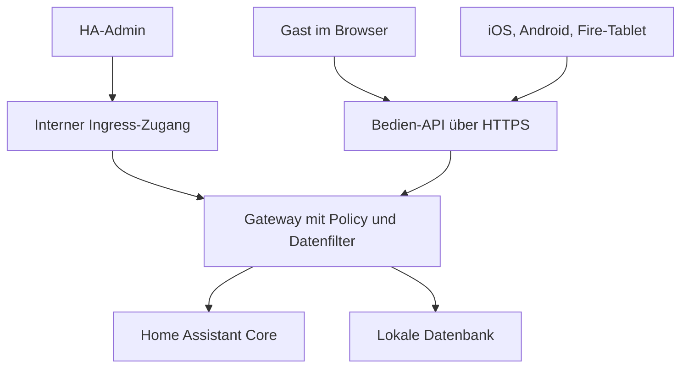

# HA Access UI – Produkt- und Implementierungsspezifikation

**Version:** 1.0 · **Recherchestand:** 22. Oktober 2026 · **Sprache:** Deutsch  
**Zweck:** Vollständige Übergabe an einen Implementierungsagenten. Dieses Dokument beschreibt ein zu entwickelndes Produkt; es ist kein bereits implementiertes oder sicherheitsgeprüftes System. „HA Access UI“ ist ein beschreibender Arbeitstitel, keine Aussage über eine Zugehörigkeit zum Home-Assistant-Projekt.

## 0. Auftrag an den Implementierungsagenten

Entwickle eine lokal betriebene Home-Assistant-App mit eigener Administration, serverseitiger Rechteverwaltung und responsivem Bedienpanel. Bewohner, Gäste und Wandtablets verwenden eigene eingeschränkte Zugänge. Die Administration erfolgt in Home Assistant. Native Pakete für iOS, Android und unterstützte Fire-Tablets ergänzen denselben Bedienumfang um Gerätefunktionen.

Der zentrale Arbeitsablauf lautet: **Raum auswählen → erlaubte Aktionen und Werte festlegen → Ansicht als Benutzer prüfen → Zugang ausgeben → Zugang gezielt oder automatisch beenden.**

Arbeite in den Phasen aus Abschnitt 18. Beginne mit den Kompatibilitätsnachweisen, dann mit einem vollständigen vertikalen Funktionspfad. Liefere keine Oberfläche, deren Sicherheitsregeln erst später angebunden werden sollen. Bei einem fehlgeschlagenen Sicherheitsnachweis bleibt die betreffende Funktion deaktiviert. Dokumentiere eine notwendige Architekturänderung mit Begründung; ersetze verbindliche Anforderungen nicht still durch schwächere Varianten.

### 0.1 Verbindliche Grundregeln

1. HA- und Supervisor-Zugangsdaten bleiben ausschließlich auf dem Gateway-Server.
2. Jede Leseausgabe, jede Aktion und jedes Live-Ereignis wird serverseitig autorisiert. Ein verborgenes Bedienelement ist kein Berechtigungsschutz.
3. Standard ist verweigern. Unbekannte Aktionen, Felder, Ressourcen und nicht verifizierbare Identitäten werden abgelehnt.
4. Gäste erhalten kein allgemeines HA-Konto und keinen frei verwendbaren HA-API-Kanal.
5. Admin-Ingress und öffentlicher Bedienzugang besitzen getrennte Authentifizierung und Routen.
6. Der Client entscheidet weder über seine Identität noch über seine tatsächlichen Rechte. Alle vom Client gelieferten Grenzen sind unverbindlich.
7. Die Fremdansicht benutzt dieselbe Policy- und Datenprojektion wie der Zielbenutzer. Sie führt standardmäßig keine physischen Aktionen aus.
8. Ablauf, Sperrung und Checkout wirken auch auf bereits offene Verbindungen.
9. Zugangscodes sind zufällig, begrenzt gültig und widerrufbar. Ein dauerhafter Zimmer-QR ist kein dauerhafter Zugangsschlüssel.
10. Physische Befehle werden nach Offlinephasen oder unklarem Ergebnis nicht automatisch nachgeholt.
11. Die native App enthält ihre UI-Dateien selbst. Vom Gateway kommen Daten und deklarative Konfiguration, kein beliebiger ausführbarer Code mit Zugriff auf eine native Bridge.
12. Lizenzierung und Geräteberechtigung sind getrennte Systeme. Ein Kauf erteilt keine Hausrechte; ein Lizenzdienst-Ausfall verändert keine Geräteberechtigung.

## 1. Konkrete Produktidee und Zielgruppe

### 1.1 Nutzenversprechen

„Gib Menschen genau die Raumfunktionen, die sie brauchen, und prüfe vorher genau, was sie sehen und bedienen können.“

Das Produkt verbindet drei Oberflächen:

| Oberfläche | Nutzer | Hauptaufgaben |
|---|---|---|
| Administration in HA | Eigentümer, zunächst HA-Admins | Räume und Geräte zuordnen, Gruppen und Regeln verwalten, Zugänge ausgeben, Fremdansicht, Diagnose und Audit |
| Browser/PWA | Bewohner und Gäste | Freigegebene Raumfunktionen ohne App-Installation bedienen |
| Native Begleitapp | Bewohner, Betreiber, Wandtablets | Instanzen speichern, QR einlesen, sichere Tokenablage, optionales Pinning, Bildschirm- und Wiederverbindungsfunktionen |

Erste Zielgruppe sind technisch betreute Haushalte, Ferienwohnungen und kleine Beherbergungsbetriebe mit einer bestehenden HA-Installation. Große Hotelketten mit PMS-Anbindung, zentraler Flottenverwaltung und garantierter Hochverfügbarkeit sind eine spätere Ausbaustufe.

### 1.2 Drei Referenzfälle

**Familie:** Ein Kind kann in seinem Zimmer Licht ein- und ausschalten. Im Flur ist nur Ausschalten erlaubt. Das Thermostat lässt 19–23 °C zu. Private Kameras, Anwesenheitsdaten und andere Schlafzimmer erscheinen nicht in der API-Antwort. Der Elternteil kann die Kinderansicht ohne Kenntnis des Passworts prüfen.

**Wandtablet:** Ein eigenes Displayprofil bedient Wohnzimmer und Küche. Das Tablet ist weder Admin noch ein gemeinsam verwendetes Bewohnerkonto. Es zeigt große Karten, einen sichtbaren Verbindungszustand und keinen Bearbeitungsmodus. Beim Verlust des Tablets kann genau dessen Zugang gesperrt werden.

**Ferienwohnung/Hotelzimmer:** Der Betreiber wählt Einheit 203, Zeitraum und Vorlage. Der Gast öffnet einen individuellen QR-Link im Browser und kann Licht, Jalousie und Temperatur 19–24 °C bedienen. Er braucht kein HA-Konto, kein Herstellerkonto und keine kostenpflichtige App. Checkout beendet alle zugehörigen Sitzungen. Ein nachfolgender Gast sieht keine Historie seines Vorgängers.

### 1.3 Klare Produktgrenze

Das Gateway begrenzt Zugriffe **über dieses Produkt**. Es ist keine nachträgliche globale Berechtigungsschicht für sämtliche HA-Schnittstellen. Wer zusätzlich ein HA-Konto, einen Geräteherstellerzugang oder einen anderen Steuerweg besitzt, behält die dort erlaubten Möglichkeiten. Automationen und physische Schalter können weiterhin Zustände verändern. Ein zulässiger Sollwertbereich garantiert keine physische Raumtemperatur und keine globale Thermostatsperre.

## 2. Rechercheergebnis und Differenzierung

Die folgende Bewertung basiert auf öffentlich zugänglichen Primärquellen. Produkte wurden nicht installiert oder unabhängig auditiert. „Nicht dokumentiert“ bedeutet nicht, dass eine Funktion sicher fehlt.

| Vergleich | Belegter Stand | Konsequenz für das Produkt |
|---|---|---|
| Home Assistant | Visuelle Sections-Dashboards, Bereichsansichten und automatische Dashboards existieren bereits. Sichtbarkeitsregeln sind nicht mit einer umfassenden Aktions-ACL gleichzusetzen. [H8, H9] | Kein Verkaufsargument „HA kann nur YAML“. Fokus auf verständliche Freigaben, Gastabläufe, Vorschau und geringeren Pflegeaufwand. |
| GlassHome | Lokale Oberfläche, serverseitige Raum-/Benutzerrechte, Displayprofile, QR-Einladung, Ablauf und responsive Layouts. Einladung verlangt nach dokumentiertem Ablauf ein Passwort. Namen gesperrter Räume/Geräte bleiben sichtbar. [W1–W3] | QR und responsive Darstellung sind allein kein Unterschied. Vollständig ausgeblendete fremde Metadaten, konkrete Aktionsgrenzen und die Kombination mit Vorschau und Aufenthalten sind stärkere Ansatzpunkte. |
| FezVrasta/ha-rbac | Rechte für bestehende HA-Nutzer, Filter-/Proxyansatz, Rollen und Lernfunktion; ausdrücklich Alpha. [W5] | Interessant, wenn bestehende Lovelace-Oberflächen erhalten bleiben müssen. Unser engeres eigenes Protokoll ist eine andere Architekturentscheidung. |
| SamAthanas/user-rbac | Domain-, Entitäts- und Aktions-/Service-Rechte; Eingriffe in Core-Funktionen, als instabil bezeichnet. [W6] | Einzelne Aktionen erlauben ist keine neue Erfindung. Lesedatenschutz und wartbare End-to-End-Abläufe sind eigenständig zu lösen. |
| SharpTools | Browserfreigabe mit Interact/View Only; kostenloses Gastkonto erforderlich. Mehrere Standorte sind vorhanden. [W7, W8] | Weder Dashboardfreigabe noch mehrere Standorte als exklusives Merkmal vermarkten. |
| Fully Kiosk / Dashie | Bestehende, funktionsreiche Tablet-/Kioskangebote; Dashie ist kostenlos und unterstützt auch Fire-Tablets. [W9, W10] | Eine verkaufte App braucht Mehrwert über eine vollflächige Webseite hinaus. |

Eine echte Admin-Vorschau als anderer Benutzer wird konkret im HA-Forum nachgefragt. Das belegt einen nützlichen Arbeitsablauf, keine quantifizierte Marktgröße. [W11]

**Priorisierte Differenzierungshypothesen:**

1. Aktionsrechte mit Parametergrenzen, verständlich formuliert und serverseitig durchgesetzt.
2. Exakte, erklärbare Fremdansicht einschließlich Zeitfenster und Bildschirmgröße.
3. Zugriff auf ein Zimmer ohne Kontoanlage, mit sauberem Aufenthalts- und Widerrufsmodell.
4. Vollständige Ausblendung fremder Ressourcen einschließlich Namen und Historie.
5. Wiederverwendbare Zimmer- und Rechtevorlagen mit nachvollziehbarer Gerätezuordnung.
6. Ein gepflegtes Grundlayout für viele Auflösungen statt verpflichtend mehrerer unabhängiger Dashboardkopien.

Diese Kombination ist eine zu validierende Produktthese. Vor größerem Ausbau sollen passende Betreiber sie an ihrem tatsächlichen Setup verwenden und für den konkreten Ablauf bezahlen wollen; reine Interessensbekundungen genügen nicht.

## 3. Architektur und Installationsweg

### 3.1 Entscheidung: eine HAOS-App als primäres Paket

Home Assistant nennt die früheren Add-ons inzwischen Apps. HAOS verwaltet sie über die GUI; eigene Repositories lassen sich hinzufügen. HA Container besitzt diesen App-Installationsweg nicht. HACS ist für die hier gewählte App nicht erforderlich. [H1–H3]

**Geplanter HAOS-Ablauf:**

1. Das veröffentlichte Hersteller-Repository über die HA-GUI hinzufügen.
2. „HA Access UI“ installieren und starten.
3. Die Adminoberfläche über Ingress öffnen.
4. Voraussetzungen prüfen, Räume/Geräte bestätigen, erste Gruppe anlegen.
5. Gastadresse und TLS einrichten und mit einem realen Gastgerät prüfen.
6. Die Fremdansicht kontrollieren und einen Zugang ausgeben.

Installation und Rechtekonfiguration sollen ohne YAML möglich sein. Eine auf dem Gasttelefon erreichbare HTTPS-Adresse ist ein eigener Einrichtungsschritt. Eine lokale Adresse funktioniert nur bei passender Netzverbindung und DNS-Auflösung. Ein bestehender HA-Cloudzugang oder Ingress erzeugt nicht automatisch eine anonyme Gastadresse.



Der Gateway-Prozess ist eine vertrauenswürdige Komponente mit weitreichendem HA-Zugriff. Sein enger nach außen sichtbarer Vertrag ist die Sicherheitsgrenze; die HA-Verbindung selbst ist kein pro Gast eingeschränktes Token.

### 3.2 Zwei Listener, getrennte Rechte

| Eigenschaft | Admin-Ingress | Bedienzugang |
|---|---|---|
| Beispielport | 8099, nicht am Host veröffentlicht | 8443, erst nach Einrichtung aktiviert |
| Identität | Verifizierter HA-Admin über Supervisor | Eigene Benutzer-, Gast- oder Display-Session |
| Erreichbarkeit | Tatsächlicher Supervisor-Peer | Konfigurierte HTTPS-Adresse oder vertrauenswürdiger Reverse Proxy |
| Routen | Admin-API und Admin-UI | Login, Enrollment, freigegebenes Dashboard und Aktionen |
| Identitätsheader | Nur vom überprüften Supervisor | `X-Remote-User-*` niemals als Identitätsnachweis |
| Admin-Mutationen | Erlaubt nach aktueller Rollenprüfung | Im MVP nicht registriert |

Zwei getrennte ASGI-Anwendungen können einen Prozess und einen gemeinsamen Backend-Kontext verwenden. Ressourcen, DB und HA-Verbindung werden genau einmal initialisiert. Kein allgemein erreichbarer Proxy darf ungeprüft die Identität des Supervisors nachbilden. Cookie-Namen, Session-Zweck und Listenerbindung müssen verhindern, dass ein kopiertes Admin-Cookie am Bedienzugang Adminrechte erzeugt.

### 3.3 App-Konfiguration

Folgender Ausschnitt beschreibt die beabsichtigten Eigenschaften, kein vollständiges veröffentlichungsfertiges Manifest. Versionsfelder und Imageadresse ergänzt die Implementierung nach erfolgreichem Kompatibilitätstest. [H4]

```yaml
name: HA Access UI
slug: ha_access_ui
arch:
  - aarch64
  - amd64
startup: application
boot: auto
ingress: true
ingress_port: 8099
panel_admin: true
homeassistant_api: true
hassio_api: false
auth_api: false
docker_api: false
host_network: false
ports:
  8443/tcp: null
backup: hot
backup_pre: /opt/ha-access/backup-export
backup_post: /opt/ha-access/backup-cleanup
backup_exclude:
  - "*/state"
  - "*/state/*"
```

Live-Daten liegen unter `/data/state`, bereinigte Backup-Exporte unter `/data/backup`. Die beiden genannten Hookprogramme werden als Teil des Produkts implementiert. Die Exclude-Muster sind ein zu verifizierender Konfigurationsentwurf: Vor Freigabe ist das tatsächlich erzeugte Archiv auf vollständigen Ausschluss der Live-Daten zu prüfen. Bei `backup: cold` werden diese Hooks nicht ausgeführt; deshalb nutzt der gewählte Exportpfad `hot` mit konsistentem SQLite-Snapshot und Bereinigung gemäß Abschnitt 15.3. [H4]

Kein Docker-Socket, keine Bearbeitung von HA-`.storage`, kein allgemeiner HA-Konfigurationsmount. Für TLS kann ein eng begrenzter schreibgeschützter Zertifikatszugriff vorgesehen werden. Zertifikatspfade müssen relativ zum erlaubten Mount validiert werden; keine beliebigen Dateipfade vom Gast übernehmen. Zugangsdaten gehören nicht in App-`options`, die unabhängig von der eigenen Datenbank in Supervisor-Metadaten gesichert werden können.

Für HA Container folgt ein eigenständiges OCI-Paket mit persistentem Volume und separater Einrichtung. Das wird nicht als Installation über die HA-GUI beworben. Persönliches HA-OAuth für dessen Administration ist vor dieser Erweiterung gesondert zu spezifizieren.

### 3.4 Admin-Authentifizierung und aktuelle Supervisor-Änderungen

Im Oktober 2026 wurde `panel_admin` serverseitig abgesichert und die Filterung von Ingress-Identitätsheadern verbessert. Für dieses Produkt wird **Supervisor mindestens 2026.10.3** verlangt. Ingress kann Rollen bestehender Sitzungen zwischenspeichern; ein eigenes aktuelles Admin-Prüfergebnis ist deshalb zusätzlich erforderlich. [H5, H6]

Verbindlicher Ablauf:

1. `GET http://supervisor/info` mit dem App-Token lesen; `data.supervisor` auswerten. Dieser Endpoint benötigt keine zusätzliche Supervisor-Verwaltungsrolle. Eine Core-Mindestversion ersetzt diesen Check nicht. [H7]
2. Der Adminlistener akzeptiert nur den tatsächlichen Supervisor-Netzwerkpeer entsprechend dem offiziellen Ingress-Vertrag, derzeit `172.30.32.2`. Die Prüfung erfolgt vor jeder Umdeutung durch Proxyheader. Fehlende, doppelte oder mehrdeutige Identitätsheader ablehnen. [H5]
3. `X-Remote-User-Id` als stabile ID verwenden. Namen dienen nur der Anzeige.
4. Über `ws://supervisor/core/websocket` mit `SUPERVISOR_TOKEN` den Befehl `config/auth/list` ausführen. Benutzer exakt anhand der ID suchen; `is_active && (is_owner || group_ids enthält system-admin)` verlangen.
5. Vor jeder Admin-Mutation und Ausgabe sensibler Admindaten frisch prüfen. Bei längeren Admin-Abonnements spätestens alle fünf Sekunden erneut prüfen; bei Fehler, Herabstufung oder Deaktivierung schließen. Ein Verbindungsproblem darf keine gespeicherte Adminberechtigung unbegrenzt verlängern.
6. Zusätzlich Sessionbindung, CSRF-Schutz und Prüfung des erwarteten Origins verwenden. Admin-URLs und Assets müssen unter dem dynamischen Ingress-Prefix funktionieren; keine hart codierte Root-URL.

`config/auth/list` ist im offiziellen Core-Code vorhanden und wird vom Supervisor selbst verwendet. Die Recherche hat diesen Pfad nicht gegen laufende Stable-Images getestet. **Ein erfolgreicher Test mit den unterstützten Stable-Versionen ist deshalb das erste Freigabegate.** `auth/current_user` mit dem gemeinsamen App-Token prüft nicht den menschlichen Ingress-Nutzer und ist kein Ersatz. Bei inkompatiblem API-Vertrag bleibt Admin-SSO gesperrt. [H10]

### 3.5 HA-Adapter

Der Server verwendet die dokumentierte Core-Verbindung über den Supervisor: REST unter `http://supervisor/core/api/` und WebSocket unter `ws://supervisor/core/websocket`. Eine gemeinsame Verbindung verwaltet Snapshot, Zustandsänderungen, Wiederverbindung und bestätigte Serviceaufrufe. App-Token niemals direkt gegen beliebige vom Nutzer übermittelte Hosts senden. [H11]

Ein versionsbezogener Adapter kapselt Registry-/Capability-Abfragen und normalisierte Aktionen. Die öffentliche API akzeptiert keine freien HA-URLs, WebSocket-Kommandos, Jinja-Templates, YAML-Dateien, `domain/service`-Kombinationen oder ungeprüftes `service_data`.

## 4. Technologiestack

| Schicht | Festlegung | Begründung und Grenze |
|---|---|---|
| Backend | Python, FastAPI, Pydantic 2 | Typisierte HTTP-/WebSocket-Verträge, asynchroner HA-Adapter; genaue Versionen beim Start festhalten. [F1] |
| Datenhaltung | SQLite, SQLAlchemy 2, Alembic | Ein lokaler Gatewayprozess; WAL, aktivierte Foreign Keys, geordnete Migrationen. Kein Redis oder Cluster im MVP. [F2] |
| Web-UI | React, TypeScript, Vite | Gemeinsame Komponenten für Administration, Gastansicht und native Pakete. Buildziel explizit wählen. [F3] |
| UI-Bausteine | Radix Primitives, eigene Designtokens und kompatibles CSS | Fokusführung und Tastaturbausteine; Produkt muss selbst Beschriftung, Kontrast und Touchbedienung sicherstellen. [F4] |
| Layout | CSS Grid/Flexbox, Media Queries; Container Queries optional | Ein robustes Grundlayout; kein Zwang zu einem frei positionierten Pixelraster. |
| Native Pakete | Capacitor 8 als geprüfte Ausgangsbasis | Gemeinsame Web-UI mit echten nativen Erweiterungen; keine vollständig in SwiftUI/Compose gezeichnete Oberfläche. [F5] |
| Nativer Transport | Eigener kleiner Capacitor-Adapter; Android Kotlin/OkHttp, iOS Swift/URLSession | HTTPS und WSS, instanzbezogenes Vertrauen, einheitliche Fehler; Bibliotheks-/API-Kompatibilität im Spike prüfen. |
| Tests | pytest für Policy/Backend, Browser-E2E mit Playwright, reale mobile Geräte | Schwerpunkt auf Autorisierung, Datenfluss, Netzfehlern und Plattformgrenzen. Keine bloße Snapshot-Sammlung. |

**Nicht blind aktuelle shadcn-/Tailwind-Defaults übernehmen:** Tailwind 4 setzt Chrome 111, Safari 16.4 und Firefox 128 voraus. Vites Standardziel ist ebenfalls modern; ein niedrigeres JavaScript-Ziel ergänzt keine fehlenden CSS-Funktionen. Für ältere Tablets ist eine bewusst kompatible CSS-Basis nötig. [F3, F6]

**Alternativen:** Flutter ist sinnvoll, wenn eine vollständig appzentrierte Oberfläche Vorrang bekommt; es kann auch Webanwendungen. React Native/Expo teilen TypeScript/Fachlogik, verwenden aber nicht dieselben DOM-Bausteine wie die Webadministration. Für den hier wichtigen Browsergastzugang und Editor ist React mit Capacitor die Ausgangsempfehlung, keine behauptete Benchmarküberlegenheit. [F7]

## 5. Domänenmodell und Datenhaltung

MVP: eine Gatewayinstanz verbindet genau eine HA-Instanz. Eine Unterkunft kann mehrere Einheiten/Zimmer enthalten. Globale Verwaltung mehrerer Installationen bleibt eine spätere Funktion.

| Tabelle/Objekt | Wesentliche Felder und Regeln |
|---|---|
| `instance` | ID, Name, HA-Verbindungsmodus, Public Origin, Zeitzone, Schema-/Policyversion, Featurestatus |
| `unit` | ID, Name, erlaubte Ressourcenbindungen, Templateversion; eine physische Wohnung/ein Zimmer oder ein privater Bereich |
| `principal` | ID, Typ `resident/guest/display`, Status, Anzeigename; keine Adminrechte allein aus diesem Typ |
| `credential` | Principal, normalisierter Benutzername, Passwort-Hash, Änderungszeit; keine Klartextpasswörter |
| `group` | ID, Name, Beschreibung; Sammlung von Personen/Displays |
| `membership` | Principal, Gruppe, Gültigkeit; eindeutig und mit Foreign Keys |
| `role_template` | Versionierte Grants, Denies und vorgeschlagene Bedienkarten |
| `assignment` | Principal oder Gruppe, Rollenversion, expliziter Ressourcen-/Einheitsscope |
| `fence` | Zwingende zusätzliche Einschränkung auf Instanz-, Einheit-, Personen- oder Sessionebene |
| `resource_binding` | Produkt-ID, HA-Registry-ID soweit verfügbar, aktuelle Entity-ID, Typ, Unit, Adapter, bestätigte Fähigkeiten, Status |
| `stay` | Einheit, Start/Ende in UTC, Status, optionale externe Buchungsreferenz; kein Gastname erforderlich |
| `invite` | Hash des zufälligen Secrets, Zweck, Zielscope, Redeem-Ende, Stay, verbraucht/widerrufen |
| `session` | Hash/Tokenfamilie, Principal, Audience, Gerät, Scopeobergrenze, gültig ab/bis, letzte Aktivität, Widerruf |
| `dashboard` | Versioniertes deklaratives Layout, Bindungen, Gruppenreihenfolge, optionale Viewport-Overrides |
| `command` | ID, Session, Idempotency-Key, normalisierte Anfrage, Policyversion, Status, HA-Kontext soweit verfügbar |
| `audit_event` | Zeitpunkt, tatsächlicher Akteur, effektiver Principal, Operation, Ergebnis, Grundcode, Ressourcen-ID |

SQL-Foreign-Keys auf jeder Verbindung aktivieren. Eindeutige Indizes für Benutzername, Tokenhash und `(session_id, idempotency_key)`; Versionierung/Optimistic Locking für Adminänderungen. SQLite-WAL ersetzt keine Backupstrategie. Zunächst genau ein Backendworker; mehrere Uvicorn-Worker ohne gemeinsamen Widerrufs-/Eventmechanismus sind verboten.

Registryänderungen müssen geprüft werden: Ein automatisch neu entdecktes Gerät erhält keine Rechte. Bleibt die Registryidentität stabil, kann eine Entity-ID-Umbenennung nach Adaptervalidierung nachvollzogen werden. Geräteersatz, Bereichswechsel und veränderte Fähigkeiten erzeugen eine Adminprüfung; bis dahin werden betroffene neue Aktionen gesperrt. HA-Gruppenentitäten mit indirekten Zielen sind zunächst nicht als einzelne sichere Aktoren zugelassen.

## 6. Rechte: verbindliche Semantik

### 6.1 Entscheidungsfunktion

Die zentrale Funktion lautet konzeptionell:

`decide(authenticated_context, resource_id, action, normalized_parameters, server_time) -> decision`

Der Kontext stammt ausschließlich aus einer verifizierten Session. Er enthält Principal, Session-/Stay-Obergrenzen und die aktuelle Policyversion. Vor jeder Aktion müssen folgende Bedingungen gemeinsam erfüllt sein:

1. Session, Principal und gegebenenfalls Aufenthalt sind aktiv.
2. Ressource existiert, ist bestätigt, unterstützt die Aktion und liegt im Scope.
3. Die Anfrage entspricht dem exakten Parameterschema.
4. Mindestens ein vollständiger passender Grant erlaubt die Anfrage.
5. Kein passender expliziter Deny verbietet sie.
6. Alle zwingenden Fences sind erfüllt.
7. Der aktuelle Adapterzustand erlaubt eine sichere Übersetzung in einen expliziten HA-Aufruf.

**Mehrere Gruppen:** Grants werden als Vereinigung vollständiger Regeln ausgewertet. Parameterbedingungen einer Regel bleiben zusammen. Bereiche 18–20 °C und 22–24 °C erlauben nicht automatisch 21 °C. Spätere mehrdimensionale Regeln dürfen nicht zu einem größeren kartesischen Parameterraum vermischt werden. Denies haben Vorrang. Fences schneiden die erlaubte Menge weiter ein und können niemals Zugriff gewähren.

Die UI unterscheidet deshalb „zusätzliche Erlaubnis“ und „verbindliche Obergrenze“. Eine persönliche engere Temperaturgrenze muss als Fence gespeichert werden, damit ein breiter Gruppengrant sie nicht aufhebt.

### 6.2 Ressourcen-, Lese- und Zeitrechte

Produkt-IDs statt frei übermittelter HA-Entity-IDs verwenden. Anzeigenamen und Produkt-IDs sind keine Sicherheitsbarriere; jede Auflösung wird geprüft. Bereiche/Labels dienen im MVP zur Adminauswahl und werden in bestätigte Ressourcenmengen aufgelöst. Neue Bereichsmitglieder werden nicht still freigegeben.

`metadata.read`, `state.read`, `history.read` und jede Bedienaktion sind getrennte Rechte. Ein ausdrücklich freigegebener Blind-Bedienknopf kann ohne Zustandslesen existieren; dann darf der Client nicht den aktuellen Zustand erhalten. Das Erteilen einer Bedienaktion erfordert bewusst freigegebene minimale Beschriftung, erzeugt aber keine umfassenden Leserechte.

Zeitpunkte werden in UTC gespeichert, Start inklusive und Ende exklusiv ausgewertet. Standortzeitpläne verwenden eine gespeicherte IANA-Zeitzone. Sommerzeitwechsel und doppelte lokale Uhrzeiten müssen definierte Tests haben. Clientzeit und Smartphonezeitzone erteilen keine Rechte. Bei nicht vertrauenswürdiger Serverzeit werden zeitabhängige Gastzugänge gesperrt, bis die Zeit korrigiert ist.

Im MVP ist Historie für Gäste deaktiviert. Eine spätere Aktivierung schneidet jede Abfrage zusätzlich auf das aktuelle Aufenthaltsfenster; aktuelle Leseberechtigung allein berechtigt nicht zum Verlauf vorheriger Gäste.

### 6.3 Aktionsmatrix für die erste Version

| Typ | Öffentliche Aktion | Erlaubte Parameter | Besondere Prüfung |
|---|---|---|---|
| Schalter | `switch.on`, `switch.off` | Keine | Nur explizite einzelne Ziele |
| Licht | `light.on`, `light.off` | Keine im ersten Adapter | Kein Flash, Profil, relativer Helligkeitsschritt oder frei durchgereichtes Zusatzfeld |
| Licht | `light.set_level` | Ganzzahlig `level_pct` 0–100 | Separates Dimmrecht; 0 verlangt zusätzlich Aus, positive Werte konservativ Ein |
| Klima | `climate.set_temperature` | Dezimalstring `target_c` | Bereich, Gerätefähigkeit, Schrittweite und Einheit prüfen; kein verstecktes `hvac_mode` |
| Klima | `climate.set_mode` | Freigegebener Enumwert | Separater Grant; nur bestätigte Modi; Aus gesondert bewerten |
| Jalousie | `cover.open`, `cover.close`, `cover.stop` | Keine | Jede Aktion einzeln freigeben |
| Jalousie | `cover.set_position` | Ganzzahlig `position_pct` 0–100 | Eigenes Positionierungsrecht; 0 verlangt zusätzlich Schließen, 100 Öffnen, Zwischenwerte konservativ beide Richtungsrechte |
| Sensor | Zustandslesen | Keine Aktion | Nur typisierte freigegebene Messwerte |

Ein Toggle wird nicht als allgemeiner HA-Service angeboten. Sind Ein und Aus erlaubt und ist der Zustand bekannt, kann ein UI-Schalter den passenden expliziten Befehl senden. Ist nur Aus erlaubt, zeigt die Karte einen klaren „Ausschalten“-Button. Ein unbekannter Zustand führt nicht zu einem geratenen Toggle.

Home Assistant dokumentiert bei Lichtaktionen Parameter mit indirekter Wirkung, etwa Helligkeit null als Ausschalten. Die Kontrolle eines Service-Namens allein genügt nicht. [H12]

### 6.4 Temperatur und weitere Parameter

MVP-Schreibunterstützung gilt zunächst für bestätigte Einzel-Sollwertgeräte mit Celsiusbasis. Entscheidend ist ausdrücklich auch die aktuelle Einheit des HA-API-Vertrags: vor Temperatur-/Modusschreibaktionen `get_config.unit_system.temperature` sowie die relevanten Entity-Capabilities prüfen. Der erste Adapter verlangt Celsius. Nach HA-Wiederverbindung oder Konfigurationsänderung bleiben Schreibaktionen bis zur erneuten Validierung gesperrt. Die native Geräteeinheit allein genügt nicht. Geräte beziehungsweise HA-Konfigurationen mit Fahrenheitbasis, zwei Sollwerten oder nicht verifizierter Semantik bleiben gesperrt, bis ein eigener getesteter Adapter vorliegt. Die UI darf sie als nicht unterstützt kennzeichnen, statt Werte fehlerhaft umzurechnen.

`target_c` wird aus einem begrenzten Dezimalstring in eine exakte Dezimalzahl geparst. Effektiver Bereich = Grantmenge geschnitten mit Fences und Gerätegrenzen. Die Schrittweite bezieht sich auf einen expliziten Adapter-Nullpunkt. NaN, Unendlich, zusätzliche Felder und nicht darstellbare Schritte ablehnen. Nicht still klemmen oder runden. Ein Sollwertauftrag ändert niemals nebenbei den HVAC-Modus. Presets und Away-/Eco-Modi sind separate Fähigkeiten, zunächst gesperrt. [H13]

Auch ein separater Moduswechsel kann gespeicherte Sollwerte oder andere Regelungsarten aktivieren. `climate.set_mode` wird daher nur bei ausdrücklich geprüfter Adaptersemantik angeboten. Für einen Principal mit Temperatur-Fence müssen die durch den Moduswechsel wirksam werdenden Sollwerte innerhalb seiner Grenzen liegen. Ist dies nicht zuverlässig nachweisbar, bleibt der Moduswechsel gesperrt. Automatik-/Doppelsollwertmodi dürfen den eingeschränkten Einzel-Sollwertadapter nicht umgehen.

Beispiel: Gast darf 19–24 °C in 0,5-Grad-Schritten. `21.5` ist zulässig; `24.1`, `21.3` und `30` werden serverseitig abgelehnt. Ein zustandsändernder Geräteknopf oder eine HA-Automation kann dennoch später einen anderen Sollwert setzen; diese Grenze wird im Adminhilfe-Text erklärt.

### 6.5 Szenen, Sammelaktionen und Änderungen

Ein eigenes Raumpreset besteht aus einer festen Liste normalisierter Produktaktionen. Vor dem Start müssen sämtliche Zielaktionen erlaubt sein; unzulässige Mischmengen werden vollständig abgelehnt. Vor jedem tatsächlichen Versand erneut Ablauf und Widerruf prüfen. Bei einem Fehler während der Ausführung Teilstatus anzeigen; HA bietet hier keine garantierte geräteübergreifende Transaktion. Kein automatisches Zurückschalten als vermeintliches Rollback.

Freie HA-Skripte, HA-Szenen, Assist, Automationsbearbeitung, Webhooks und freie Services sind nicht Teil des ersten Bedienvertrags. Eine spätere Freigabe benötigt überprüfte indirekte Wirkungen, feste Parameter und erneute Freigabe nach Änderung.

Jede wirksame Policyänderung erhöht eine monotone `policy_version`. Offene Clients erhalten einen neuen gefilterten Snapshot beziehungsweise Entfernenachrichten. In der Single-Worker-Architektur müssen Dispatch, Widerruf und Datenprojektion eine eindeutige Reihenfolge besitzen: Nach dem Commit einer Sperrung startet kein neuer Befehl mit alten Rechten. Bereits an HA übergebene Aktionen können nicht rückwirkend zurückgenommen werden.

## 7. Beispielkonfiguration und Referenzszenario

Das folgende JSON zeigt einen normativen fachlichen Ausschnitt. Es ist keine HA-Konfiguration und noch kein versprochenes Importformat. Die endgültigen Pydantic-Modelle und JSON-Schemas müssen diese Semantik abbilden und unbekannte Felder verbieten.

```json
{
  "schema_version": 1,
  "unit": {
    "id": "unit_203",
    "name": "Zimmer 203",
    "resource_ids": ["res_main_light", "res_thermostat", "res_blind"]
  },
  "role": {
    "id": "role_room_guest",
    "version": 1,
    "grants": [
      {
        "resources": ["res_main_light", "res_thermostat", "res_blind"],
        "actions": ["metadata.read", "state.read"]
      },
      {
        "resources": ["res_main_light"],
        "actions": ["light.on", "light.off"]
      },
      {
        "resources": ["res_thermostat"],
        "actions": ["climate.set_temperature"],
        "parameters": {
          "target_c": {"min": "19", "max": "24", "step": "0.5", "origin": "0"}
        }
      },
      {
        "resources": ["res_blind"],
        "actions": ["cover.open", "cover.close", "cover.stop"]
      }
    ],
    "denies": [
      {
        "resources": ["res_main_light", "res_thermostat", "res_blind"],
        "actions": ["history.read"]
      }
    ]
  },
  "stay": {
    "id": "stay_example",
    "unit_id": "unit_203",
    "starts_at": "2026-11-01T14:00:00Z",
    "ends_at": "2026-11-04T10:00:00Z"
  },
  "session_scope": {
    "unit_ids": ["unit_203"],
    "stay_id": "stay_example",
    "role_id": "role_room_guest",
    "role_version": 1
  }
}
```

Eine Rolle ohne passende `resources`-Liste darf nicht implizit „alles“ bedeuten. Vorlagen können beim Anlegen eines Zimmers Platzhalter wie „Hauptlicht“ enthalten; die veröffentlichte Instanz muss vollständig auf bestätigte Ressourcen aufgelöst sein. Fehlt die Zuordnung, bleibt die betreffende Karte deaktiviert beziehungsweise unveröffentlicht.

Ein Admin kann die Änderung einer Vorlage vorbereiten und als Differenz sehen: neue Sichtbarkeit, neue Aktionen, weitere Wertebereiche und betroffene aktive Gäste. Veröffentlichung ist ein versionierter Vorgang. Bereits existierende Zuweisungen wechseln nur durch einen ausdrücklichen, protokollierten Rollout auf die neue Vorlagenversion.

## 8. Anmeldung, QR und Zugangslebenszyklus

### 8.1 Drei Zugangsarten

**Bewohner:** Benutzername und Passwort; kein Login nur anhand eines Namens. Benutzernamen werden nach einer dokumentierten Normalisierung eindeutig gespeichert. Passwörter mit einer gepflegten Argon2id-Implementierung hashen; Parameter auf der Zielhardware messen und festhalten. Lange Passphrasen erlauben, keine eigenen Kryptoverfahren. Rate Limits, gleichartige Fehler für unbekannte Namen und falsche Passwörter sowie protokollierter Reset durch den Admin sind erforderlich. Passkeys sind eine spätere Komfortfunktion. [S1]

**Gast:** QR-/Link-Enrollment mit einem zufälligen Einmalcode. Es entsteht ein temporärer Principal beziehungsweise eine eingeschränkte Session, kein allgemeines Bewohnerkonto. Ein Anzeigename ist optional. Pro Gerät ein eigener widerrufbarer Zugang.

**Display:** Pairing eines eigenen Displayprofils. Das Tablet zeigt eine kurzlebige Pairinganfrage; ein Admin bestätigt das konkrete Gerät und dessen Scope. Ein kurzer Zahlencode ist nur ein rate-limitierter Verweis auf die Anfrage und niemals allein eine dauerhafte Berechtigung. Pairinganfrage standardmäßig zehn Minuten gültig.

### 8.2 Individueller Gast-QR

Empfohlener Link: `https://panel.example.org/join#i=<zufaelliges_einmalsecret>`.

1. Admin wählt Einheit, Rolle, Aufenthaltszeit und Anzahl der Gastgeräte. Standard: ein Secret pro Gerät; kein frei wiederverwendbarer gemeinsamer Link.
2. Server erzeugt mindestens 256 Bit kryptografischen Zufall, speichert nur einen Hash und zeigt den vollständigen QR genau zur Ausgabe an.
3. Einlösefrist standardmäßig 15 Minuten, vom Admin verlängerbar bis maximal 24 Stunden und nie über das Aufenthaltsende hinaus. Einlösefrist und spätere Nutzungsdauer werden getrennt angezeigt.
4. Der Browser liest den Fragmentwert, entfernt ihn sofort aus der sichtbaren Adresse und sendet ihn per HTTPS-POST im Body. Die Einstiegsseite lädt keine fremden Skripte, Fonts oder Analytics. Referrer, Serverlogs, Fehlerreports und Screenshots der Administration dürfen keine Secrets sammeln.
5. Der Server prüft Zweck, Einlösefrist, Widerruf, Scope und Aufenthaltsstatus und konsumiert das Secret atomar mit der Sessionerzeugung. Zeitlich noch nicht gestartete Aufenthalte geben keine Bedienrechte; das Secret darf vor Beginn eine wartende Session erzeugen, deren erste Gerätefreigabe erst nach `starts_at` erfolgt.
6. Wiederverwendung schlägt fehl. Bei verlorenem Antwortpaket nach erfolgreichem Verbrauch muss ein neuer Zugang ausgegeben werden; kein unsicherer Wiederverwendungsmodus als Fehlerbehelf.
7. Der Gast sieht ausschließlich seine freigegebene Einheit. Weitere Telefone erhalten separate Einladungen, die zum selben Aufenthalt gehören können.
8. Beim Checkout oder manuellen Widerruf werden alle betroffenen Session-/Refreshfamilien und noch nicht verbrauchten Einladungen gesperrt.

Ein Fragment vermeidet das Senden des Secrets in der ursprünglichen HTTP-URL; es macht den QR selbst nicht geheim. Das vollständige Einladungsbild und der Link sind bis zur Einlösung sensible Zugangsdaten. QR-Generatoren müssen lokal laufen, ohne Daten an externe Bilddienste zu senden.

### 8.3 Statischer Zimmer-QR

Ein gedruckter dauerhafter QR öffnet nur die Einstiegsseite oder identifiziert eine Zugriffsanfrage. Die Berechtigung entsteht durch einen Aufenthaltscode oder ausdrückliche Bestätigung. Ein fotografierter alter Zimmer-QR darf keinen unbegrenzten neuen Zugang ermöglichen.

Für den ersten Hotelpilot wird der **individuelle Aufenthalt-QR** verwendet. Statische Schilder sind optionaler Komfort mit zusätzlichem Freigabeschritt. Ein Buchungs-/PMS-Connector ist später möglich, muss aber seine eigene Authentifizierung, Idempotenz und Widerrufslogik erhalten.

### 8.4 Sessionregeln

| Client | Vorgabe |
|---|---|
| Browser | Hostgebundenes `Secure`, `HttpOnly`, geeignetes `SameSite`-Cookie; individueller Instanzname; CSRF-Token und Origin-Prüfung für Mutationen |
| Native App | Kurzlebiges Access-Token im Speicher; rotierbares Refresh-Token in Keychain/Keystore; kein Token in normaler Preferences-Datei |
| Admin-Ingress | Verifizierte Ingressidentität und aktuelle HA-Rolle; CSRF-Nachweis an Benutzer und Ingresskontext binden; keine am öffentlichen Listener akzeptierte Adminsession |
| WebSocket | Browser-Cookie plus Originprüfung oder über HTTPS ausgestelltes kurzlebiges Einmalticket; native Authentifizierung im Protokoll; keine langlebigen Tokens in URL-Querystrings |

Native Access-Tokens: Zielwert 15 Minuten. Bewohner-Refreshfamilien: zunächst höchstens 30 Tage bis erneuter Anmeldung. Displayfamilien: bewusst längere, vom Betreiber verwaltete Laufzeit möglich; immer widerrufbar, keine Unendlichkeit ohne sichtbaren Status. Gästesitzungen enden spätestens am Aufenthaltsende, unabhängig von Tokenrotation oder Aktivität. Alle Werte sind Produktdefaults und müssen konfigurierbar sein, ohne maximale Scopes zu erweitern.

Refresh-Token werden rotiert, alte Wiederverwendung führt zur Sperrung der betroffenen Familie. Clientseitige Refresh-Aufrufe serialisieren, damit normale parallele Requests keine Wiederverwendungsalarme auslösen. Unbekannte Native-Origins sind kein Ersatz für Authentifizierung; die native Verbindung muss ein gültiges Sitzungstoken besitzen.

Credentials sind an Instanz-ID und kanonischen HTTPS-Origin einschließlich Port gebunden. Auth-/API-Endpunkte dürfen im MVP nicht auf einen anderen Origin weiterleiten; Clientadapter lehnen Redirects dort insgesamt ab. Codes, Cookies und Access-/Refresh-Token dürfen niemals automatisch an einen neuen Host weitergereicht werden. Host-/Portwechsel benötigen einen ausdrücklich authentifizierten Migrationsablauf oder erneutes Enrollment.

Abmeldung löscht lokale vertrauliche Daten und widerruft die Session. Ein PWA-Service-Worker darf UI-Assets cachen, aber keine personalisierten API-Antworten, Enrollmentantworten, Kamerabilder oder Zugangstokens. Bei bekannter lokaler Ablaufzeit werden sichtbare Gerätezustände sofort entfernt. Ein serverseitiger Widerruf wirkt im Client nach Empfang oder der nächsten Prüfung; ein offline oder suspendierter Client kann ihn nicht augenblicklich erfahren. Beim Verlust der Verbindung werden Steuerung und Liveabonnement gesperrt. Ein bereits angezeigter Zustand darf höchstens 30 Sekunden klar als veraltet sichtbar bleiben, danach wird er entfernt. Beim Fortsetzen der App vor erneuter Anzeige zunächst Session und Snapshot prüfen. Bereits zuvor vom Benutzer gespeicherte Informationen können technisch nicht zurückgerufen werden.

### 8.5 Erreichbarkeit und TLS im Setup-Assistenten

Der Assistent prüft getrennt: Gateway läuft, HA-Verbindung besteht, Public Origin stimmt, TLS ist gültig, WSS funktioniert und ein echtes Gastgerät erreicht die Instanz. Ein Test ausschließlich vom HA-Server beweist keine Erreichbarkeit im Gast-WLAN.

Unterstützte Betriebsarten:

- Eigener HTTPS-Listener mit Zertifikat/Schlüssel aus einem erlaubten lokalen Pfad.
- Externer HTTPS-Reverse-Proxy mit exakt konfigurierten vertrauenswürdigen Peers. Plaintext hinter dem Proxy nur in einem isolierten lokalen Transportnetz; der entsprechende Port darf nicht allgemein für Gäste erreichbar sein.

Public Origin ist eine explizite Adminkonfiguration. Keine automatische Ableitung aus beliebigen `Host`-/Forwarded-Headern. Gast-WLAN muss DNS und den gewählten Gatewayport erreichen können; die HA-Oberfläche und weitere interne Geräte müssen dafür nicht freigegeben werden. Ein optionaler Remotezugang ist ein eigenständiger Betriebsmodus, keine implizite Portfreigabe durch den Assistenten.

### 8.6 Ersatz, Verlängerung und Zimmerwechsel

Verbrauchter/abgelaufener QR, gelöschte Browserdaten, ein geschlossenes privates Fenster, ein anderes Telefon oder ein anderer Browser erhalten einen verständlichen Hinweis mit dem konfigurierten Betreiberkontakt. Der einfache Adminablauf lautet „alten Gerätezugang sperren und Ersatz ausgeben“. Dabei werden nur der betroffene Gerätezugang und seine Refreshfamilie beendet; andere berechtigte Geräte desselben Aufenthalts bleiben erhalten, sofern der Admin nicht den ganzen Aufenthalt sperrt.

Eine Aufenthaltsverlängerung muss ausdrücklich anzeigen, ob bestehende aktive Zugänge mitverlängert werden. Bei Zustimmung werden Aufenthalt, Sessionobergrenzen und zulässige Refreshlaufzeiten gemeinsam aktualisiert; verbrauchte Einladungen werden nicht wieder freigegeben. Erreichbare Clients erhalten das neue Ende und erneuern ihre Browsercookies beziehungsweise Tokens über einen authentifizierten Renewalpfad. Dieser Pfad kann keine weitergehenden Rechte erzeugen. Für bereits abgelaufene, widerrufene oder nicht mehr wiederherstellbare Zugänge wird ein neuer QR ausgegeben. Die Adminansicht unterscheidet aktualisierte und neu einzuladende Geräte.

Ein Zimmerwechsel beendet die alten Raumfreigaben und erstellt einen neu zu prüfenden Zielaufenthalt samt Einladung. Keine stille Erweiterung einer bestehenden Session auf zusätzliche Räume. Eine noch nicht ausgegebene Einladung und ein Aufenthaltsentwurf sind bereits in der Fremdansicht prüfbar.

## 9. Datenprojektion und Live-Verbindungen

Aus HA-Daten entstehen typisierte Produktobjekte. Für jeden Gerätetyp gibt es eine Positivliste zulässiger Felder. Keine vollständigen HA-Attribute, Registryobjekte, Kameratokens, internen URLs, Koordinaten, Personeninformationen oder Entityreferenzen ungeprüft kopieren.

Der Server liefert nur Ressourcen, für die der Nutzer mindestens die erforderlichen Metadatenrechte besitzt. Räume ohne sichtbare Ressourcen werden ebenfalls entfernt. Öffentliche Such-, Zähl-, Fehler- und Paginationantworten dürfen die Existenz fremder Ressourcen nicht verraten. Eine nicht vorhandene und eine nicht freigegebene Ressourcen-ID erhalten denselben öffentlichen Fehler `NOT_FOUND`.

Ein autorisierter Blick auf eine Karte darf enthalten:

```json
{
  "id": "res_thermostat",
  "kind": "climate",
  "label": "Raumtemperatur",
  "state": {
    "availability": "online",
    "current_c": "21.0",
    "target_c": "21.5",
    "observed_at": "2026-11-01T15:00:00Z"
  },
  "capabilities": {
    "climate.set_temperature": {
      "target_c": {
        "intervals": [{"min": "19", "max": "24"}],
        "step": "0.5",
        "origin": "0"
      }
    }
  }
}
```

Ein Lesebenutzer bekommt keine Schreibcapabilities. Ein Benutzer ohne `state.read` erhält kein `state`-Objekt. Die ausgelieferten Capabilities helfen der UI, sind aber kein signierter Freibrief: Jeder spätere Request wird erneut gegen aktuelle Serverregeln geprüft.

Zustandsänderungen werden aus einer gemeinsamen HA-Verbindung verteilt. Für jedes ausgehende Ereignis wird die aktuelle Session und Policy angewandt. Aufgestaute Nachrichten werden nach einer Sperrung verworfen oder neu projiziert. Cache-Schlüssel enthalten effektiven Principal, Session-Scope und Policyversion; keine Wiederverwendung eines Admin-Snapshots für Gäste.

Jedes Protokollereignis trägt eine Verbindungs-/Snapshotgeneration und eine Sequenz. Nach Reconnect wird zunächst ein vollständiger autorisierter Snapshot gesendet; alte Deltas werden nicht blind weitergespielt. Der Client entfernt zuvor vorhandene, jetzt fehlende Ressourcen. Ziel für sichtbaren Widerruf: spätestens fünf Sekunden bei erreichbarer Verbindung; serverseitige neue Aktionen werden bereits unmittelbar nach dem Sperrcommit abgelehnt. [S2, S3]

## 10. Fremdansicht als Kernfunktion

### 10.1 Bedienung

Admin wählt einen tatsächlichen Bewohner, Gast, ein Displayprofil oder den Entwurf einer noch nicht eingelösten Einladung. Zusätzlich kann eine konkrete Session beziehungsweise ein Aufenthalt gewählt werden, denn derselbe Principal kann verschiedene Sessionobergrenzen haben. Die Einladungsvorschau verwendet exakt die geplanten Gruppen, Räume, Grenzen, Start-/Endzeiten und Sessionobergrenzen, ohne bereits eine nutzbare Zugangssession zu erzeugen. So funktioniert „prüfen, dann QR ausgeben“ auch beim ersten Gast. Für eine reine Gruppenvorschau wird eine ausdrücklich markierte hypothetische Person ohne weitere Gruppenrechte verwendet.

Die Ansicht zeigt:

- Zielperson, zugehörige Gruppen, Scope, Gültigkeit und Policyversion.
- Das exakt projizierte Dashboard des gewählten Kontexts.
- Viewportauswahl und frei veränderbare Vorschaugröße.
- Optional einen hypothetischen Berechtigungszeitpunkt.
- Im Adminbereich eine Erklärung je Karte/Aktion: erlaubende Regel, blockierender Deny, Fence oder fehlende Fähigkeit.

**Banner:** „Vorschau als Gast Zimmer 203 · Simulation · Aktionen werden nicht ausgeführt.“ Die Vorschau darf nicht versehentlich wie eine normale Adminsteuerung aussehen.

### 10.2 Technische Umsetzung

Ein Admin-Endpunkt erzeugt einen kurzlebigen Previewkontext mit `purpose=preview`, tatsächlicher Admin-ID, effektivem Zielkontext und Ablauf. Dieser Kontext ist keine reguläre Gästesitzung und wird an allen ausführenden Endpunkten abgelehnt.

Die Vorschau ruft denselben Renderer, dieselbe Datenprojektion und dieselbe reine Entscheidungsfunktion auf wie die reale Ansicht. Ein Simulationsklick liefert `would_allow`, normalisierte Parameter und Admin-Grundcodes, erzeugt aber keinen HA-Serviceaufruf. Hypothetische Zeiten verändern lediglich die Policybewertung; sie erzeugen keine historischen oder zukünftigen Gerätezustände. Aktuelle Messwerte werden entsprechend bezeichnet.

Ein Live-Test ist optionaler späterer Ausbau: ausdrückliche Aktivierung, ausschließlich echte Serverzeit, aktiver Admin als tatsächlicher Akteur und Zielbenutzer als effektiver Principal im Audit. Kein Login als anderer Benutzer und kein Kenntnisbedarf für dessen Passwort. Ein Live-Test darf nicht zusätzliche Rechte des Admins in den Zielkontext mischen.

### 10.3 Prüfung vor Veröffentlichung

Adminänderungen an Rollen und Vorlagen erhalten eine Vorher-/Nachher-Vorschau. Die Vorschau nennt hinzugekommene Lese- und Aktionsrechte. Veröffentlichung erfolgt über einen separaten Button mit Versionsprüfung. Änderungen an einer alten Editorversion ergeben einen Konflikt und überschreiben keine neueren Regeln.

## 11. Responsive Dashboard und Editor

### 11.1 Darstellungsprinzip

Eine semantische Struktur aus Einheiten, Funktionsgruppen und Karten bildet die Grundlage. Die Standardreihenfolge bleibt über Bildschirmgrößen gleich. Karten wechseln ihr internes Layout abhängig vom verfügbaren Platz. Es gibt keine frei injizierbaren HTML-/JavaScript-Widgets im MVP.

Empfohlene Grundstruktur: Raumname und Verbindungsstatus; wenige wichtige Aktionen; Klima/Licht/Beschattung; danach zusätzliche Sensoren. Betreiberinformationen, Roh-Entity-IDs, Policybegriffe und Diagnose gehören in die Administration. Gerätestörungen werden in Alltagssprache sichtbar, ohne technische Fehlermeldungen aus HA ungefiltert an Gäste auszugeben.

### 11.2 Größen und Layout

Die folgenden Werte sind Produktziele, keine bereits gemessenen Eigenschaften:

| Breite in CSS-Pixeln | Zielverhalten |
|---|---|
| 320–599 | Eine Hauptspalte; kompakte Aktionsgruppen können zwei Elemente nebeneinander zeigen |
| 600–899 | Zwei Kartenbereiche, wenn Inhalte und Schriftgröße passen |
| 900–1399 | Drei bis vier flexible Spalten; gut für Querformat-Wandtablets |
| Ab 1400 | Begrenzte Inhaltsbreite, bei Bedarf bis sechs Spalten; keine endlos auseinandergezogenen Regler |

Grid `auto-fit/minmax` oder vergleichbare inhaltsabhängige Regeln verwenden. Die Tabelle ist keine starre Geräteerkennung. 200-%-Textvergrößerung, Bildschirmtastatur, Safe Areas und Hoch-/Querformat müssen ohne abgeschnittene Hauptaktionen funktionieren. Mindestens 44 × 44 CSS-Pixel für primäre Touchziele, im Wandmodus vorzugsweise 64 Pixel. Tastatur- und Screenreaderbedienung, sichtbarer Fokus, kontrastreiche Zustände, reduzierte Animation und kein alleiniger Farbcode sind erforderlich.

Container Queries können Karten verbessern, dürfen aber nicht Voraussetzung für die bedienbare Grundansicht sein. Ältere WebViews brauchen den Grid/Flexbox-/Media-Query-Pfad. Lange Bezeichnungen umbrechen; Zahlen und Einheiten zusammenhalten. Diagramme sind nachrangig, sparsam und nur bei expliziten Leserechten.

### 11.3 Editorumfang

MVP: Gruppen sortieren, Karten sortieren, bevorzugte Kartengröße, Beschriftung, Symbol, sichtbare freigegebene Funktionen und Theme auswählen. Drag-and-drop besitzt eine Tastatur-/Buttonalternative. Ein Vorschaugerät ist nur eine Darstellungshilfe; die eigentliche Autorisierung bleibt unabhängig vom Layout.

Ein Grundlayout gilt für alle Breiten. Optionale Overrides dürfen Reihenfolge, Spanne und Dichte ändern; sie duplizieren weder Rechte noch Gerätebindungen. Vorlagen speichern semantische Platzhalter und werden beim Anwenden an ein konkretes Zimmer gebunden. Dashboard-Imports werden validiert und dürfen keine fremden Ressourcen automatisch freigeben.

MVP-Themes: hell, dunkel und kontrastreich; deutsche und englische UI-Texte. Die Architektur verwendet Übersetzungsschlüssel, damit weitere Sprachen später ergänzt werden können. Gastsprachwahl folgt zunächst Browsersprache mit manuellem Wechsel und gespeichertem Default. Kein automatischer Übersetzungsdienst für private Gerätedaten.

### 11.4 Befehls- und Verbindungszustände

Ein visueller Klickzustand darf nicht mit Erfolg verwechselt werden. Anzeigen unterscheiden mindestens:

- Anfrage wird geprüft/gesendet.
- HA hat die Aktion angenommen.
- Ein passender Gerätezustand wurde beobachtet.
- Aktion fehlgeschlagen.
- Ergebnis unklar oder Gerät nicht erreichbar.

Ein HA-Serviceerfolg ist keine sichere physische Rückmeldung. Ein beobachteter Zustand ist nicht immer eindeutig dem eigenen Befehl zuzuordnen. UI und Audit müssen diese Unsicherheit erhalten. Bei Verbindungsverlust Zustände höchstens während des 30-Sekunden-Fensters aus Abschnitt 8.4 als veraltet zeigen, Bedienelemente deaktivieren und nach Wiederverbindung neu autorisieren und laden. Keine Offline-Warteschlange für physische Aktionen.

## 12. API-Vertrag

Versionierter Namespace `/api/v1`. Öffentliche und Adminrouten werden an unterschiedlichen Listenern registriert. Pydantic/OpenAPI ist die maßgebliche Schemabasis; daraus TypeScript-Typen generieren. Unbekannte zusätzliche Requestfelder sind Fehler. Allgemeine Aktionsbody-Grenze zunächst 16 KiB, kein freies Hochladen im Gastprotokoll.

### 12.1 Bedien-API

| Methode/Route | Zweck | Berechtigung |
|---|---|---|
| `GET /api/v1/public/config` | Minimale Login-/Instanzdarstellung, keine Geräteliste | Öffentlich, rate-limitiert |
| `POST /api/v1/auth/login` | Benutzername/Passwort | Login-/CSRF-Prüfung, Rate Limit |
| `POST /api/v1/auth/redeem` | Einmalcode gegen Session tauschen | Codevalidierung, atomarer Verbrauch |
| `POST /api/v1/auth/refresh` | Native Tokenrotation | Gültige Refreshfamilie |
| `POST /api/v1/auth/session/renew` | Browsercookie nach erlaubter Laufzeitänderung erneuern | Noch aktive Session, CSRF; kein Erweitern des serverseitigen Scopes |
| `POST /api/v1/auth/logout` | Eigene Session widerrufen | Aktuelle Session |
| `GET /api/v1/me` | Eigene Sessiondaten und Ablauf | Aktuelle Session |
| `GET /api/v1/dashboard` | Projiziertes Layout und Ressourcen | Aktuelle Policy |
| `POST /api/v1/actions` | Eine normalisierte Aktion | Aktuelle Policy und Idempotency-Key |
| `GET /api/v1/commands/{id}` | Eigener Befehlsstatus | Session-/Principalbindung und aktuelle Sichtbarkeit |
| `POST /api/v1/ws-ticket` | Einmaliges kurzlebiges WS-Ticket | Aktuelle Session, CSRF |
| `WS /api/v1/events` | Gefilterte Live-Daten | Authentifizierung, laufende Sessionprüfung |

WS-Tickets gelten maximal 30 Sekunden, sind einmalig und an Instanz, Audience sowie Session gebunden. Der Verbindungsaufbau hat ein kurzes Authentifizierungstimeout und begrenzte Framegröße. Browser-Origin exakt prüfen; keine pauschalen Wildcards mit Cookies. Native Tokens werden nach demselben serverseitigen Sessionmodell geprüft.

Beispiel einer Anfrage, deren Principal aus der Session stammt:

```json
{
  "resource_id": "res_thermostat",
  "action": "climate.set_temperature",
  "parameters": {"target_c": "21.5"}
}
```

Antwort auf einen zulässigen Auftrag: `202` mit `command_id`, `status=accepted` und angewandter `policy_version`. `accepted` bedeutet zunächst Annahme im Gateway, nicht physische Ausführung. Der Client übermittelt einen `Idempotency-Key` je bewusster Nutzeraktion. Gleicher Schlüssel mit anderem Body ergibt einen Konflikt; gleicher Schlüssel und gleicher Body erzeugt keinen zweiten Versand.

Eine Wiederholung nach einem Serverabsturz kann keine universelle Genau-einmal-Garantie für HA-Geräte liefern. Persistierte, unklare Aufträge werden als `unknown` wiederhergestellt und nicht automatisch erneut ausgeführt.

Öffentliche Fehler: `UNAUTHENTICATED`, `NOT_FOUND`, `ACTION_NOT_ALLOWED`, `INVALID_PARAMETERS`, `ACCESS_EXPIRED`, `UPSTREAM_UNAVAILABLE`, `RATE_LIMITED`, `CONFLICT`. Fehlertexte verraten keine fremden Ressourcen, interne URLs, Tokens oder Stacktraces. Detaillierte Policygründe sind nur für die Administration verfügbar.

### 12.2 Admin-API

Unter `/api/v1/admin` werden versionierte CRUD-/Publish-Operationen für Einheiten, Ressourcenbindungen, Principals, Gruppen, Rollen, Fences, Aufenthalte, Einladungen und Dashboards angeboten. Ergänzend:

- `POST /preview`: Previewkontext erzeugen.
- `GET /preview/{id}/dashboard`: identische Projektion für den Zielkontext.
- `POST /preview/{id}/simulate`: reine Policyentscheidung ohne HA-Aufruf.
- `POST /stays/{id}/checkout`: Aufenthalt, Einladungen und Sessions gemeinsam beenden.
- `POST /sessions/{id}/revoke`: einzelnes Gerät beziehungsweise Session sperren.
- `GET /audit`: paginierte, gefilterte Adminereignisse.
- `GET /diagnostics`: redigierte Betriebs-/Versionsdaten.
- `POST /config/export`: validiertes Konfigurationspaket ohne aktive Secrets.

Jede Mutation benötigt die erwartete Objektversion, einen CSRF-Nachweis und die frische HA-Adminprüfung. Rollen-/Aufenthaltsänderung und Widerruf werden transaktional gespeichert. Import, Restore und globale Sicherheitsänderungen sind privilegierte Vorgänge mit eigener Prüfung; Gastclients besitzen keine entsprechenden Routen.

### 12.3 Ereignisformen

```json
{
  "type": "resource.updated",
  "generation": "connection_7",
  "sequence": 18,
  "policy_version": 42,
  "resource": {
    "id": "res_main_light",
    "kind": "light",
    "label": "Hauptlicht",
    "state": {"power": "off", "availability": "online"},
    "capabilities": {"light.on": {}, "light.off": {}}
  }
}
```

Weitere Typen: `snapshot`, `resource.removed`, `policy.changed`, `command.updated`, `session.revoked`, `connection.status`. Nach `session.revoked` werden Anzeige und Verbindung beendet. Ein neuer Client muss eine frische authentifizierte Verbindung herstellen; das alte Ticket ist nicht wiederverwendbar.

## 13. Native Apps, Fire OS und Certificate Pinning

### 13.1 Umfang der nativen Begleitapp

Die App ist ein signiertes natives Paket mit gemeinsam genutzter Weboberfläche und gezielten nativen Modulen. Sie öffnet keine beliebige fremde Webseite mit freigeschalteter Capacitor-Bridge. Lokale UI-Assets werden über den Store beziehungsweise signierte Releases aktualisiert. Das Gateway liefert ausschließlich ein validiertes Dashboard-Schema und Daten. [F5]

Erste native Funktionen:

- Mehrere gespeicherte Instanzen mit getrennten Sessions und Vertrauensprofilen.
- QR-Scanner und manuelle Eingabe einer Instanzadresse.
- Keychain-/Keystore-Tokenablage und optionale lokale biometrische Entsperrung.
- Kontrollierter HTTPS-/WSS-Transport einschließlich optionalem Pinning.
- Wiederverbindung nach WLANwechsel und App-Fortsetzung.
- Wandmodus mit optionalem Wachhalten, Orientierung, Dunkelmodus und Sperre der App-Einstellungen.
- Lokal verfügbare UI und verständlicher Verbindungsstatus; Geräteaktionen benötigen weiterhin einen erreichbaren Gatewayserver.

QR-Scanner für Android/Fire müssen ohne nachinstallierte Google Play Services funktionieren. Geeigneter Ausgangspunkt ist ein lokaler Decoder wie ZXing mit einer geprüften Kameraanbindung; auf iOS eine native Kamera-/QR-Schnittstelle. Konkrete Pluginversionen werden im Gerätespike ausgewählt und fixiert. Kein Cloud-Upload von QR-Inhalten.

Kamera- und lokale Netzwerkberechtigungen je Plattform deklarieren und im passenden Nutzungsschritt verständlich anfordern. Ablehnung, spätere Freigabe in den Systemeinstellungen und Rückkehr aus dem Hintergrund gehören in den Gerätetest. Keine pauschalen ATS-/Cleartext-Ausnahmen einsetzen, um einen fehlgeschlagenen lokalen Netzwerkaufbau zu kaschieren.

Eine App-interne PIN sperrt nur deren Einstellungen. Ein echter Betriebssystem-Kiosk benötigt passende Geräteverwaltung. iOS, Standard-Android und Fire OS haben dafür unterschiedliche Möglichkeiten; weder ein Capacitor-Plugin noch Immersive Mode garantiert auf allen Geräten eine ausbruchsichere Sperre. [W10]

### 13.2 Plattformmatrix

Capacitor 8 nennt Android API 24 und iOS 15 als technische Basis. Das ist nicht automatisch das Produktminimum jeder UI und jedes Plugins. [F5]

| Plattform | Entscheidung für die erste Freigabe |
|---|---|
| Web Desktop | Aktuelle stabile Chrome-, Edge-, Firefox- und Safari-Version; getestete Versionsmatrix veröffentlichen |
| iPhone/iPad | Produktziel zunächst iOS/iPadOS 16.4 oder neuer; zusätzlich ein aktuelles Gerät testen. iOS 15 erst nach gesondertem vollständigem UI-/Plugin-Nachweis |
| Android | Native Mindest-API zunächst 24 als Buildbasis, tatsächliche Freigabe nach WebView-/Pluginprüfung; Store-targetSDK unabhängig davon aktuell halten |
| Fire HD 10 2021 | Testkandidat mit Fire OS 7/API 28; tatsächliche Firmware und WebView dokumentieren |
| Fire HD 10 2023 | Testkandidat mit Fire OS 8/API 30 |
| Fire HD 10 2019 | Zusätzlicher Altgeräte-Testkandidat; OS-Mindest-API allein schließt ihn nicht aus |
| Fire HD 10 2017 | API 22 liegt unter dem gewählten Capacitor-8-Minimum; kein Zielgerät |
| Neue Alexa Tablets | Separater Android-/Google-Play-Vertriebspfad laut aktueller Amazon-FAQ; nicht mit Fire OS gleichsetzen |
| Fire TV/Vega | Nicht Bestandteil dieser ersten Tablet-/Smartphone-Freigabe |

Die Fire-Gerätedaten und die neue Alexa-Tablet-Verteilung stammen aus Amazons Dokumentation. Eine belastbare aktuelle WebView-Version für jedes ältere Fire-Modell wurde nicht ermittelt. Kompatibilität darf deshalb erst nach realem Test zugesagt werden. [F8, F9]

Im ersten Spike werden Browser-/WebView-Engine, Grafikleistung, Speicher, QR-Scanner, HTTPS/WSS, Bildschirmfunktionen und längerer Wandbetrieb erfasst. Das Vite-Buildziel und CSS-Funktionsprofil folgen dieser Messung. Ein modernes Standardbuild ohne tatsächliche Altgerätetests ist keine Fire-Unterstützung.

### 13.3 Browser-TLS und natives Pinning

Normales Browser-JavaScript besitzt keine eigene TLS-Pinning-Schnittstelle. Der kostenlose Gastbrowser verwendet die Zertifikatsprüfung des Browsers. Optionales Pinning ist eine Funktion des nativen Clients. CapacitorHttp dokumentiert HTTP-/fetch-/XHR-Verbindungen, aber keinen vollständigen WSS-Pinning-Pfad; es reicht allein nicht als Sicherheitsnachweis. [F10]

Anforderungen an den nativen Transport:

1. Reguläre Zertifikatsketten- und Hostnamenprüfung bleiben aktiv.
2. Optional pro Instanz zusätzlich SHA-256-SPKI-Pins prüfen, mit mindestens einem vorgesehenen Ersatzpin.
3. HTTP, WebSocket, Weiterleitungen und spätere Medienpfade müssen denselben Vertrauensregeln folgen. Im ersten Release keine Kameramedien, die einen ungeprüften Zusatzpfad öffnen.
4. Bei Zertifikatswechsel mit gleichem Schlüssel kann der Pin weiter passen; Schlüsselwechsel braucht einen geplanten Übergang.
5. Alte und neue Schlüssel während eines begrenzten Übergangs akzeptieren. Neue Pins nur über eine bereits authentifizierte Verbindung oder erneutes vertrauenswürdiges Enrollment übernehmen. Jede Änderung des Trustprofils schließt vorhandene HTTP-Pools und WebSocket-Verbindungen; anschließende Verbindungen werden neu geprüft. Entfernte Pins dürfen nicht über bereits offene Kanäle weiterwirken.
6. Bei unbekanntem Pin Verbindung abbrechen. Kein automatisches Abschalten von Pinning, kein `trust all`, kein stiller HTTP-Fallback und kein Ablaufdatum, das unbemerkt die Bindung entfernt.
7. Pin bezieht sich auf den tatsächlichen TLS-Endpunkt. Bei Reverse-Proxy-Terminierung ist dessen Schlüssel maßgeblich, nicht ein internes Gatewayzertifikat.
8. Ein Gerätewechsel, Restore oder vollständiger Schlüsselverlust benötigt einen klaren Wiederherstellungsablauf. Pro Instanz gespeicherte Vertrauensdaten dürfen sich nicht auf andere Instanzen auswirken.

Als Ausgangspunkt werden unter Android OkHttp mit kontrollierter Pin-/Trustkonfiguration und unter iOS URLSession einschließlich WebSocket und Server-Trust-Prüfung untersucht. Der Spike muss nachweisen, dass beide Netzwerkpfade dieselbe Entscheidung treffen. Statische Domainlisten allein reichen für beliebige erst später eingerichtete Kundeninstanzen nicht. [F11]

Ein QR kann Adresse, Instanz-ID, Einmalcode und Fingerprint transportieren. **Die Herkunft dieses QR muss vertrauenswürdig sein.** Ein Angreifer, der Adresse und Fingerprint gemeinsam austauscht, wird nicht durch das bloße Vorhandensein eines Fingerprints erkannt. Die native App muss das Secret erst nach erfolgreicher TLS-/Pinprüfung senden.

Selbst signierte Zertifikate/private CAs sind ein späterer, ausdrücklich eigener Enrollmentmodus. Sie werden nicht durch eine allgemeine Ausnahme von der Zertifikatsprüfung unterstützt. Der Browsergastpfad setzt ein Zertifikat voraus, das dessen Browser regulär akzeptiert.

### 13.4 Deep Links

HTTPS-QRs funktionieren im Browser. In der nativen App wird derselbe Zugang über den integrierten Scanner importiert. Universal Links/App Links benötigen kontrollierte Domainzuordnung; eine einzige App kann nicht ohne weitere Einrichtung sämtliche beliebigen selbst gehosteten Kundendomains als verifizierte Links beanspruchen. Ein Hersteller-Linkdienst ist ein optionaler späterer Komfortdienst, keine Voraussetzung für lokalen Betrieb. [F12]

### 13.5 Store-Vertrieb

Eine hybride App ist nicht pauschal unzulässig. Apple fordert allerdings einen nutzbaren Mehrwert über eine verpackte Webseite hinaus. Native Funktionen, ein vollständiger Demoablauf und ein nachvollziehbares Preismodell gehören zur Storevorbereitung. QR-Anmeldung darf nicht mit einem QR-Verfahren zur Umgehung kostenpflichtiger Funktionsfreischaltungen verwechselt werden. Die konkreten Zahlungsregeln sind vor Einreichung je Region und Store zu prüfen. [F13]

Store-Einreichung, Signaturzertifikate, öffentliche Veröffentlichung, Bezahlkonten und Verkaufsbedingungen sind eigene Releaseschritte und werden nicht durch dieses Dokument automatisch ausgeführt.

## 14. Geschäftsmodell und Validierung

### 14.1 Empfehlung

**Gäste bedienen kostenlos im Browser; der Betreiber bezahlt Komfort und Betrieb.** Für einen Hotelaufenthalt ist der App-Kauf eine zusätzliche Hürde. Eine kostenpflichtige native App richtet sich deshalb an Bewohner, Eigentümer und dauerhaft genutzte Wandtablets.

Empfohlene Preisexperimente, ausdrücklich keine bewiesene Zahlungsbereitschaft:

| Angebot | Vorschlag für den Test | Begründung |
|---|---|---|
| Lokales Gateway und Gastbrowser | Kostenlose Basis oder vollständig nutzbare Pilotversion | Einfacher Einstieg, kein Kauf je Gast; grundlegende Sicherheit niemals paywallen |
| Native Komfortapp | 9,99 € einmalig, optional 5,99 € Einführung | Der höhere Preis lässt eher Spielraum für Pflege; Mehrwert muss durch native Funktionen sichtbar sein |
| Betreiberpaket | Pilotangebot 99 € pro Jahr und Standort für bis zu fünf Einheiten | Zu prüfen für Vorlagen, Aufenthaltverwaltung, Rollout-/Supportfunktionen; kein finaler Tarif |

App-Store-Käufe folgen den jeweiligen Konten-/Nutzungsregeln und sind nicht automatisch eine pro Tablet erworbene B2B-Lizenz. Ein Kauf in einem Store schaltet nicht ohne gesondertes Entitlement-System andere Stores frei. Keine Herstellercloud nur für die lokale Geräteberechtigung einführen. Eine spätere lokale Lizenzprüfung muss vom Policykern getrennt bleiben und bestehende erlaubte Grundbedienung bei einem Lizenzserverausfall weiter ermöglichen.

Preisanker aus der Recherche: GlassHome PRO 39,99 USD einmalig; SharpTools 30 USD/Jahr privat und 50 USD/Standort/Jahr kommerziell; Fully Kiosk PLUS 8,90 EUR zuzüglich Steuer je Gerät; Dashie kostenlos. Umfang und Lizenzgrundlage unterscheiden sich. Diese Preise beweisen keine Nachfrage für unser Produkt. [W4, W8–W10]

9,99 € einmalig ist ein zu prüfender Preis für eine schlanke Begleitapp. Ob er die Pflege trägt, hängt insbesondere von Verkaufszahl und Supportaufwand ab. Daraus folgt noch kein wirtschaftliches Hotelprodukt mit laufender Geräte-, HA- und Sicherheitswartung. Storegebühren und Steuern reduzieren den Erlös; die Gebührenmodelle variieren nach Programm und Region und haben sich 2026 teilweise geändert. Keine pauschale weltweite 70/30-Rechnung als Businessplan verwenden. [F14]

### 14.2 Kleiner realer Pilot

Vor einem breiten App-Ausbau fünf bis zehn passende Betreiber beziehungsweise Haushalte gewinnen. Mindestens drei unterschiedliche reale Setups, darunter ein Gast-WLAN und ein Fire-Tablet, müssen den vollständigen Ablauf nutzen.

Zu prüfen sind konkrete Verhaltenssignale: Schafft der Betreiber die Einrichtung? Benötigt der Gast Hilfe? Werden Temperatur-/Aktionsgrenzen tatsächlich gebraucht? Spart die Fremdansicht Zeit? Wird nach dem Test ein genanntes Angebot gekauft? Welche heutige Lösung wird ersetzt?

Vorgeschlagene interne Entscheidungsschwelle: Mindestens drei unabhängige Pilotbetreiber setzen den Ablauf im Alltag ein und akzeptieren einen konkreten Preis; die Mehrheit der beobachteten Gäste erreicht ohne Erklärung die erste erlaubte Aktion. Diese Schwelle ist eine Managemententscheidung, kein statistischer Marktnachweis. Bei guter Nutzung, aber fehlender Zahlungsbereitschaft für Apps den Betreiberpreis testen, bevor weitere Plattformfunktionen gebaut werden.

## 15. Betrieb, Sicherheit und Wiederherstellung

### 15.1 Vertrauensgrenzen

Zu berücksichtigen sind neugierige Gäste mit eigenen API-Requests, kopierte QR-Codes, verlorene Tablets, fremde Websites, veraltete Sessions, defekte Netzverbindungen und eine veränderte HA-Konfiguration. Ein vollständig kompromittierter HA-Host oder Gatewayprozess kann die lokale Vertrauensbasis brechen; ein lokales Auditprotokoll ist kein extern manipulationssicheres Beweissystem.

Das Backend verwendet strikte Schemas, serverseitige Policychecks, Größen-/Ratenlimits und vorbereitete Datenbankzugriffe. Beschriftungen sind Text, kein HTML. Öffentliche Seiten besitzen eine restriktive Content Security Policy und Clickjacking-Schutz. Die Adminseite erlaubt nur den notwendigen HA-Ingress-Einbettungskontext. CORS wird nicht pauschal für alle Origins mit Credentials aktiviert.

Eine enge Geräte-/Plattformliste begrenzt indirekte Aktionen. Auch `light`-, `switch`- oder `cover`-Entitäten können intern zusammengesetzt oder skriptgestützt sein. Eine Domain allein beweist keine einfache Gerätewirkung. Solche Bindungen bleiben gesperrt, bis ein Adapter oder eine ausdrückliche Betreiberprüfung ihre Semantik abdeckt. Durch externe HA-Automationen ausgelöste Folgeaktionen werden nicht automatisch transitiv vom Gateway geprüft.

### 15.2 Audit und Diagnose

Audit enthält tatsächlichen Akteur, effektiven Principal, Geräte-/Session-ID, Aktion, normalisierte zulässige Parameter, Policyversion und Status. HA-Kontext-ID soweit verfügbar ergänzen. Das HA-Logbuch kann nur den gemeinsamen Upstream-Nutzer sehen; personenbezogene Zuordnung erfolgt im Gatewayaudit.

Standardaufbewahrung 30 Tage, konfigurierbar. Keine Passwörter, Roh-QRs, Sessiontokens, Authorization-Header oder vollständigen HA-Payloads protokollieren. Abgelehnte Massenanfragen aggregieren, damit Audit nicht selbst einen Speicherangriff ermöglicht. Diagnoseexporte redigieren Hostdetails und Geheimnisse; der Admin kann vor Export prüfen, was enthalten ist. Keine ungefragte Telemetrie oder externe Übertragung von Hausdaten.

### 15.3 Backup und Restore

Ein wiederhergestelltes altes Backup darf weder einen bereits verbrauchten QR noch eine widerrufene Session oder ein früheres Passwort wieder gültig machen. Die Freigabe benötigt daher eine ausdrückliche, getestete Restorearchitektur; reine Dateikonsistenz genügt nicht.

Verbindliches Ergebnis eines unterstützten Restore:

- Neue Sicherheitsgeneration; alte Sitzungen, Refreshfamilien und Einladungen werden verworfen.
- Keine Übernahme alter funktionsfähiger Bewohnerpasswörter; kontrollierter Reset beziehungsweise erneutes Enrollment.
- Administration erst nach erneut verifizierter HA-Adminidentität.
- Wiederhergestellte Rollen, Bindungen und Aufenthalte zunächst prüfen; bis zur Freigabe keine Gaststeuerung.
- Neue Ressourcen-/Policygeneration an Clients; alte Clientcaches werden nicht weiterverwendet.

**Gewählter Ablauf: bereinigter Export mit Hot-Backup-Hooks.** Unter `/data/state/` liegen Live-SQLite, WAL/SHM, Schlüssel und temporäre vollständige Snapshots. Dieses gesamte Verzeichnis bleibt dauerhaft vom App-Backup ausgeschlossen. Unter `/data/backup/restore.sqlite` liegt ausschließlich ein fertiger bereinigter Export.

1. `backup_pre` erstellt mit der SQLite Online Backup API einen konsistenten Snapshot im ausgeschlossenen Arbeitsverzeichnis. Aus diesem Snapshot wird eine **neue leere Datenbank** anhand einer Positivliste von Tabellen und Spalten aufgebaut. Erlaubt sind Räume, Ressourcenbindungen, Dashboards, Rollenvorlagen und deaktivierte, zur Prüfung vorgesehene Zuordnungen. [F16]
2. Passworthashes, Sessions, Refreshfamilien, Einladungen, Schlüssel, aktive Aufenthaltsfreigaben und ausstehende ausführbare Befehle werden nicht exportiert. Nicht eine volle DB kopieren und danach Zeilen löschen: gelöschte Inhalte könnten in freien DB-Seiten verbleiben. Alle temporären Vollkopien bleiben ausschließlich unter `/data/state/`.
3. Der fertige Export enthält Schemaversion, Exportzeit, Exportgeneration und `requires_admin_review=true`. Nach Integritätsprüfung, Schließen und dauerhaftem Schreiben wird er atomar auf den Backup-Pfad verschoben. Parallele Exporte verhindern; vor Beginn keinen alten Export als aktuellen Erfolg stehen lassen.
4. `backup_post` entfernt den lokalen Export, nachdem das Archiv seine Kopie enthält. Scheitert die Bereinigung, wird dies sichtbar gemeldet. Ein verbleibender Export bewirkt beim nächsten Start vorsichtshalber den Wiederherstellungsmodus.
5. Beim Start wird **vor Freigabe aller Bedienfunktionen** auf einen Restore-Export geprüft. Seine Anwesenheit erzwingt den Admin-Wiederherstellungsablauf, auch wenn daneben unerwartet Live-Dateien existieren. Erst nach Validierung wird eine frische Live-DB mit neuer Sicherheitsgeneration und ohne alte Credentials erzeugt. Der verifizierte Admin bestätigt Ressourcen und Freigaben und gibt neue Zugänge aus.
6. Fehlt eine Live-DB und ist kein gültiger Export vorhanden, bleibt die App im Einrichtungs-/Fehlerzustand. Keine offene Standardrolle und kein Demopasswort einsetzen. Ein normaler Neustart ohne Export nutzt dagegen den bestehenden Live-Zustand; normale Backups sollen keine erneute Anmeldung aller Nutzer erzwingen.

Dieser Weg benötigt eine laufende App beim Export. Bei gestoppter App, Pre-Hook-Fehler, Prozessabbruch oder fehlendem Export darf es keinen Rückfall auf ein vollständiges Backup der Live-Sicherheitsdaten geben. Ein insgesamt erstelltes HA-Backup belegt nicht automatisch, dass der App-Export erfolgreich war; App-Backupstatus gesondert anzeigen.

Vor Freigabe tatsächliche Archive auf geheime Live-Inhalte prüfen sowie vollständigen/partiellen Restore auf leerem und vorhandenem Datenbestand ausführen. Alte Gatewaypasswörter und Tokens müssen auch nach dem Adminreview ungültig bleiben. Die Zusage betrifft Gatewayzugänge: Welche HA-eigenen Konten ein vollständiges HA-Backup wiederherstellt, kontrolliert diese App nicht. Rohes Kopieren einer laufenden WAL-Datenbank ist kein unterstütztes Ersatzverfahren.

### 15.4 Updates und Migrationen

Reproduzierbare Containerbuilds für amd64/aarch64, fixierte Abhängigkeiten, Migrationsversionen, Artefaktprüfsummen und veröffentlichte getestete HA-/Supervisorversionen. Datenbankmigrationen vor Öffnung der Bedienlistener durchführen. Fehler lassen die Bedienung geschlossen und zeigen eine redigierte Adminmeldung.

Vor einer Migration einen konsistenten Konfigurationsstand sichern. Rollback ist nur mit dazu passendem Datenstand zulässig; keine ältere Binärversion ungeprüft auf eine neue DB setzen. Bei unklarer HA-Protokoll-/Adapterkompatibilität betroffene Schreibfunktionen sperren und den Grund anzeigen. Keine Core-Monkeypatches oder Schreibzugriffe auf HA-interne Nutzerdateien.

## 16. Leistung und Qualitätsziele

Folgende Zahlen sind **Abnahmeziele**, keine Messwerte und kein Skalierungsversprechen:

- Erste Testlast: 500 upstream Entitäten, 100 freigegebene Ressourcen, 20 gleichzeitige Bedienclients.
- Eine gemeinsame HA-Zustandsverbindung; keine vollständige HA-Verbindung je Gast.
- Policyentscheidung im üblichen Fall unter 20 ms auf dokumentierter Referenzhardware; zusammenhängenden echten Lastfall messen.
- Sichtbare Reaktion auf einen lokalen Klick innerhalb von 150 ms; physisches Gerätefeedback gesondert bewerten.
- Erster bedienbarer Gastbildschirm im lokalen Netz innerhalb von drei Sekunden auf dem freigegebenen Referenztablet.
- Sichtbarer Widerruf bei erreichbarem Client innerhalb von fünf Sekunden; sofortige serverseitige Ablehnung neuer Aufträge nach Commit.
- 72 Stunden Wandbetrieb ohne unbegrenzt wachsenden Speicherverbrauch, veraltete dauerhafte Sessionsicht oder manuell nötigen Neustart.
- 100 zeitlich begrenzte Gastclients als spätere B2B-Laststufe erst nach separatem Test und Freigabe.

Bei Nichterreichen zuerst Messung und Engpass dokumentieren. Kein Redis-/Microservice-Ausbau ohne konkreten Bedarf. UI-Ereignisse nach Ressourcen-ID verteilen, damit ein Sensorupdate nicht das gesamte Dashboard neu rendert. Verborgene beziehungsweise nicht sichtbare Diagramme nicht unnötig aktualisieren.

## 17. Projektstruktur und Entwicklungsartefakte

Ein Monorepository mit klaren Bereichen:

| Verzeichnis | Verantwortung |
|---|---|
| `gateway/` | Auth, Policy, HA-Adapter, Datenprojektion, Persistenz, Admin-/Public-API |
| `web/` | Gemeinsame React-App mit Admin- und Bedienrouten |
| `packages/contracts/` | Generierte API-Typen und deklarative Dashboard-Schemas |
| `packages/ui/` | Gemeinsame Karten, Tokens, Formulare und Accessibility-Verhalten |
| `native/` | Capacitor-Projekte, Transport-/Trust-/Scanneradapter, Plattformkonfiguration |
| `ha-app/` | App-Manifest, Containerbau, Laufzeit-/Backupskripte, Repositorymetadaten |
| `tests/` | Policyfälle, API-/WS-Integration, reale HA-Verträge, Browser- und Plattformabnahme |
| `docs/` | Architekturentscheidungen, Setup, Geräte-/Versionsmatrix, Restore, Betriebsgrenzen |

Fachlogik wird zuerst im Backend verbindlich definiert. Die UI darf Regeln für Bedienbarkeit anzeigen, aber keine unabhängige konkurrierende Berechtigungsinterpretation entwickeln. Testfixtures verwenden synthetische Geräte und Personen. Reale Kundendaten gehören nicht in Repository oder Screenshots.

Ein lokaler HA-Simulator ist für Entwicklung sinnvoll; mindestens die sicherheitsrelevanten Vertragsprüfungen müssen zusätzlich gegen echte unterstützte Stable-Versionen laufen. Alle Beispiele im README müssen den produktiven Authentifizierungspfad verwenden. Kein `ALLOW_ALL`, festes Demopasswort oder offen erreichbarer Debugendpoint im Releaseimage.

Lizenzempfehlung: veröffentlichbarer Gateway-/Policykern und verkaufbare Komfort-/Betriebsleistungen. Die konkrete Projektlizenz und Markenwahl sind vor Veröffentlichung festzulegen. Bestehenden Konkurrenzcode nicht ohne Prüfung seiner Lizenz übernehmen; insbesondere ist ein AGPL-Projekt keine beliebig in eine proprietäre App kopierbare Komponentenquelle.

## 18. Umsetzungsphasen und Freigabegates

| Phase | Ergebnis | Verbindliches Ende |
|---|---|---|
| S0 – Nachweise | Minimale HAOS-App, Ingressidentität und aktuelle Adminprüfung; zwei Listener; HA-Lese-/Schreibadapter; Backup/Restore-Probe; früher Fire-/iOS-Transportspike | Keine unbelegte SSO-, Restore-, Pinning- oder Gerätekompatibilitätsannahme trägt das weitere Design |
| M1 – Vertikaler Kern | Ein Raum, ein Licht, ein Thermostat; Principal/Gruppe/Policy; Browserlogin; Admin-Fremdansicht; Aktion und gefiltertes Live-Update | Nicht erlaubte API-Aktion und fremder Zustand sind nachweislich blockiert; Simulation steuert kein Gerät |
| M2 – Nutzbarer Webpilot | GUI-Einrichtung, Gruppen/Rollen/Fences, Gerätebindungen, Dashboardeditor, Gast-QR, Aufenthalte, Checkout, Audit, Backups | Drei vollständige Referenzfälle auf realen Setups; relevante Tests bestanden; tatsächliche Nutzung und Akzeptanz eines konkreten Angebots entscheiden vor dem breiten M3-Ausbau |
| M3 – Native Freigabe | Android/Fire- und iOS-Pakete mit lokaler UI, sicherer Speicherung, Scanner, nativer Verbindung und optionalem Pinning | Reale Gerätematrix, Trust-/Reconnecttests und Store-Demo vorhanden; kein pauschales Altgeräteversprechen |
| M4 – Betreiberpaket | Vorlagenrollout, mehr Einheiten, Hilfsmittel für Betreiber und lizenzierter Support | Zahlungssignal aus Pilot, Last-/Betriebsnachweis und definierter Supportumfang |

Native Spikes beginnen früh, damit ein ungeeignetes altes Tablet oder ein unvollständiger WSS-Transport nicht erst nach dem Webbau entdeckt wird. Der vollständige App-Vertrieb folgt dem nutzbaren Webpilot. Eine belastbare Zeit-/Kostenplanung entsteht nach S0; ein Frameworkvergleich allein erlaubt keine seriöse Lieferzusage.

### 18.1 Bewusst spätere Funktionen

Kameras und Medien, Türschlösser/Alarm, freie HA-Skripte, Assist, eigene Drittanbieterwidgets, PMS-Synchronisierung, zentrale Verwaltung mehrerer HA-Standorte, aktive Synchronisierung verteilter Gateways, private PKI, Passkeys, Homescreenwidgets, Sprachsteuerung und Remote-Relay sind Erweiterungen. Jede benötigt einen eigenen engen Vertrag und darf die vorhandene Policy nicht umgehen.

Kleine sinnvolle Ausbauschritte nach dem Pilot: QR-Zugang für Reinigung mit Zeitfenster, weitere Gastsprachen und übersetzbare Betreiberbeschriftungen, komfortable Raumpresetvorlagen, geführter Thermostatersatz und Druckvorlagen für Aufenthalts-QRs. Grund-Sprachwahl, sichere Gerätezuordnung und Rechtevergleich vor Veröffentlichung gehören bereits zum beschriebenen Kern. Funktionsumfang nach tatsächlicher Nutzung priorisieren.

## 19. Abnahmematrix

Diese Fälle prüfen konkrete Risiken. Sie sind als automatisierte Backend-/API-Prüfung oder klar dokumentierter Gerätetest umzusetzen. UI-Verstecken allein gilt in keinem Berechtigungstest als bestanden.

| ID | Fall | Erwartetes Ergebnis |
|---|---|---|
| A01 | Öffentlicher Request mit gefälschtem `X-Remote-User-Id` | Keine Adminidentität, keine Adminroute |
| A02 | Andere App spricht den Ingressport direkt an | Ablehnung anhand tatsächlichen Peers |
| A03 | Fehlende/doppelte Header oder zu alter/unbekannter Supervisor | Adminzugang geschlossen, verständlicher Update-/Diagnosehinweis |
| A04 | HA-Admin wird bei offener Sitzung herabgestuft | Nächste privilegierte Operation verweigert; Live-Adminansicht wird geschlossen |
| A05 | Core-Rollenabfrage scheitert oder Antwortschema ändert sich | Kein Rückfall auf dauerhaft gespeicherte Adminrolle |
| A06 | Gast fordert eine fremde Ressourcen-ID an | Kein Zustand/Name; derselbe öffentliche Fehler wie bei unbekannter ID |
| A07 | Benutzer darf nur ausschalten | Direkte Ein-/Toggle-/Dimm-Aufrufe mit positiver Helligkeit scheitern |
| A08 | Benutzer darf nur einschalten | Aus, Helligkeit null, relative Schritte und unerlaubte Zusatzparameter scheitern |
| A09 | Temperaturrechte 19–24 °C/0,5 | 21,5 erlaubt; 24,1/21,3/NaN/zusätzliches `hvac_mode` verweigert |
| A10 | Zwei Grants erlauben 18–20 und 22–24 | 21 bleibt gesperrt; keine Erweiterung zur durchgehenden Spanne |
| A11 | Breiter Grant und enger Personen-Fence | Fence begrenzt trotz weiterer Gruppenberechtigung |
| A12 | Grant und expliziter Deny treffen dieselbe Aktion | Deny gewinnt |
| A13 | Unbekannte Aktion, Feld, Wildcard oder Bereichsziel im Gastrequest | Keine freie HA-Durchleitung |
| A14 | Neues Gerät erscheint im freigegebenen HA-Bereich | Keine automatische neue Gastfreigabe |
| A15 | Template-/Gruppen-/Universal-Aktor ohne bestätigte Semantik | Keine Schreibfreigabe nur wegen seiner Domain |
| A16 | HA-Temperatureinheit oder Gerätefähigkeiten ändern sich | Schreibadapter wird bis erneuter Validierung gesperrt |
| A17 | Jalousie-Zwischenposition bei nur einer Bewegungsrichtung | Keine Umgehung der gewählten Richtungsregel |
| A18 | Klima-Modus aktiviert unzulässigen Sollwert/Regelungsart | Keine Umgehung des Temperatur-Fence |
| A19 | Snapshot ist gefiltert, späteres Live-Ereignis betrifft fremden Raum | Auch das Ereignis wird nicht ausgeliefert |
| A20 | Rolle wird während offener WS-Verbindung entzogen | Keine neuen Daten/Aktionen; Ressource wird aus Client entfernt |
| A21 | Alter Admin-/Gastcache wird für anderen Principal verwendet | Test scheitert; Caches müssen korrekt getrennt sein |
| A22 | Derselbe Einmal-QR wird gleichzeitig auf zwei Geräten eingelöst | Genau ein atomarer Verbrauch gewinnt |
| A23 | Einlösefrist vorbei, Aufenthalt noch aktiv | Alter Einladungscode unbrauchbar; bestehende gültige Session darf weiterlaufen |
| A24 | Einlösung vor Aufenthaltsbeginn | Keine Gerätefreigabe vor Start; wartende Session bleibt begrenzt |
| A25 | Checkout bei geöffnetem Browser | Alle Stay-Sessions/Refreshfamilien/Einladungen gesperrt |
| A26 | Alter statischer Zimmer-QR nach Checkout | Erteilt keinen selbstständigen neuen Zugang |
| A27 | Direkter Zugriff auf vergangene Gast-Historie | Keine Daten früherer Aufenthalte |
| A28 | Fremdansicht führt Klick aus | Nur Entscheidungssimulation; kein Upstream-Serviceaufruf |
| A29 | Hypothetischer Previewzeitpunkt liegt in der Zukunft | Keine reale Aktion und keine behaupteten zukünftigen Gerätezustände |
| A30 | Simulationskontext wird an echte Aktionsroute gesendet | Zweckbindung verhindert Ausführung |
| A31 | Gleicher Idempotency-Key wird wiederholt | Kein doppelter Versand; anderer Body ergibt Konflikt |
| A32 | Gateway stürzt nach Versand vor Ergebnis ab | Nach Neustart Status unklar; kein automatischer erneuter Befehl |
| A33 | Zweite Aktion eines Raumpresets scheitert | Teilstatus sichtbar; keine behauptete Atomizität oder blinder Rollback |
| A34 | Netzverlust und spätere Wiederverbindung | Neuer gefilterter Snapshot; keine nachgeholten Offlineaktionen |
| A35 | CSRF, unerlaubter Browser-Origin, verbrauchtes WS-Ticket, rotierter Refresh-Token oder widerrufene/abgelaufene Session | Betroffene Anfrage verweigert; kein pauschales Replayversprechen für noch gültige Bearer-Tokens |
| A36 | Falscher TLS-Hostname oder unzulässiger Schlüssel | Native HTTP- und WSS-Verbindung scheitern gleichermaßen |
| A37 | Geplanter Ersatzpin und Rotation bei bereits offenen HTTP-/WSS-Verbindungen | Pools und Kanäle werden geschlossen; neue Prüfung verwendet das neue Profil; entfernter Pin bleibt gesperrt |
| A38 | Selbst signiertes Zertifikat im Standardmodus | Kein pauschales Akzeptieren oder unsicherer Fallback |
| A39 | Restore eines Backups vor QR-Verbrauch/Sessionwiderruf | Alte Codes, Sessions und frühere Gatewaypasswörter werden nicht reaktiviert |
| A40 | Normales Update/Backup ohne Restore | Kein unbeabsichtigtes Aufweiten von Rechten; Betriebsverhalten dokumentiert |
| A41 | 320 px, Tablet hoch/quer, 2560 px, 200-%-Text | Hauptaktionen ohne Abschneiden; Lesereihenfolge und Fokus bleiben sinnvoll |
| A42 | Nur Tastatur und Screenreader | Login, Dashboard, Rechteeditor und Vorschau vollständig bedienbar |
| A43 | Freigegebenes Fire-Gerät ohne Google Play Services | Scanner, Login, HTTPS/WSS und Wandmodus funktionieren |
| A44 | Echtes Gast-WLAN mit isolierten Clients | Nur vorgesehener Gatewayzugang nötig; QR-Ablauf tatsächlich nutzbar |
| A45 | Diagnose-/Audit-/Proxylogs nach Login und Enrollment | Keine Tokens, Passwörter, QR-Secrets oder vollständigen HA-Dumps |
| A46 | 72-Stunden-Wandbetrieb und Ziel-Clientlast | Dokumentierte Leistungsziele beziehungsweise begründete Freigabegrenzen |
| A47 | Backup-Archiv auf Live-Daten und Geheimnisse untersuchen | Kein State-Verzeichnis, WAL/SHM, Passwort-Hash, Token oder Schlüssel enthalten |
| A48 | Pre-/Post-Hook-Fehler, Exportabbruch oder gestoppte App | Kein unsicherer Backupfallback; Restore bleibt ohne gültigen Export gesperrt |
| A49 | Enrollment-/Refreshantwort leitet auf anderen gültigen HTTPS-Origin um | Kein Secret oder Token erreicht den anderen Origin; Redirect wird abgelehnt |
| A50 | Einladung wird vor ihrer ersten Einlösung in der Vorschau geöffnet | Exakter geplanter Stay-/Sessionkontext; keine nutzbare Gastsession entsteht |
| A51 | Aufenthalt verlängern, Browser wechseln oder Zimmer wechseln | Sichtbarer Betreiberablauf; keine still reaktivierten Codes, keine unbeabsichtigten alten Raumrechte |
| A52 | Widerruf während Client offline/suspendiert ist | Server verweigert sofort; Client beachtet lokales Ende/Stale-Fenster und prüft vor erneuter Anzeige |

## 20. Definition of Done und erste Arbeitspakete

### 20.1 Erste Arbeitspakete

1. Repository und Entwicklungsumgebung anlegen, dieses Dokument als versionierte Produktgrundlage übernehmen.
2. S0-Nachweise mit Ergebnisprotokoll, exakten HA-/Supervisor-/Pluginständen und echten Zielgeräten erstellen.
3. Domänenmodelle, Policyentscheidung und typisierte HA-Adapter implementieren; A06–A18 vor UI-Komfort verifizieren.
4. Zwei Listener, reale Adminprüfung, Gastauthentifizierung und gefilterte Live-Daten fertigstellen.
5. Einen Raum von der Adminfreigabe über die Fremdansicht bis zur erlaubten und verweigerten Geräteaktion vollständig umsetzen.
6. Aufenthalt-QR, Checkout, responsive Karten und nachvollziehbare Zustände ergänzen.
7. Restore- und Widerrufsbelege, Installationsassistent und Pilotdokumentation abschließen.
8. Erst anschließend native Releasepakete und kommerzielle Funktionen entsprechend den Phasengates fertigstellen.

### 20.2 MVP fertig, wenn

Ein neuer HAOS-Betreiber kann über die GUI installieren, zwei Räume zuordnen, eine eingeschränkte Gruppe anlegen und deren Ansicht prüfen. Ein Gast kann einen QR im Browser einlösen und nur die erlaubten Aktionen ausführen. Das Ende des Aufenthalts beendet den Zugang. API- und WS-Tests belegen den Schutz unabhängig von der UI. Das Dashboard funktioniert auf den freigegebenen Größen und Geräten. Ein getesteter Restore erzeugt keinen alten Zugang. Bekannte Plattform- und HA-Nebenzugangsgrenzen sind in der Adminhilfe verständlich beschrieben.

Die native Freigabe ist ein separater Abschluss: installierbare signierte Testpakete, getestete Trustpfade, konkrete Gerätematrix und Store-Review-Demo. Ein lokaler Browserprototyp allein erfüllt diesen Teil nicht.

## 21. Quellen und Evidenzgrenzen

Abruf-/Bewertungsstand: **22.10.2026**. Die Quellen belegen Plattformfähigkeiten, veröffentlichte Produktmerkmale und Preise. Die oben festgelegten Schemas, Defaults, Leistungsziele, Reihenfolge und Preisexperimente sind eigene Produkt-/Architekturentscheidungen. Sie sind weder gemessene Marktwerte noch ein unabhängiges Sicherheitsaudit.

### Home Assistant

- **[H1]** [Home Assistant Apps](https://www.home-assistant.io/apps/) – Bezeichnung, Installation und HAOS-Grenze.
- **[H2]** [HAOS: Drittanbieter-Repository hinzufügen](https://www.home-assistant.io/common-tasks/os/#installing-a-third-party-app-repository).
- **[H3]** [HACS: Apps](https://www.hacs.xyz/docs/faq/addons/) – Abgrenzung zu Apps/Add-ons. Bereits beschriebene Marketplace-Wege ab 2026.11 sind am Recherchestichtag noch kein Beleg für den aktuellen Stable-Installationsweg.
- **[H4]** [App-Konfiguration](https://contributors.home-assistant.io/apps/reference/configuration/) – Ingress, Rechte, Ports, Backupoptionen.
- **[H5]** [Ingress-Leitfaden](https://contributors.home-assistant.io/apps/guides/ingress/) – vertrauenswürdiger Peer, Identityheader, Prefix und WebSocket.
- **[H6]** [Supervisor PR #7308](https://github.com/home-assistant/supervisor/pull/7308) und [Release 2026.10.3](https://github.com/home-assistant/supervisor/releases/tag/2026.10.3) – `panel_admin`, Rollencache und Headerkorrekturen.
- **[H7]** [Supervisor-Endpunkte](https://contributors.home-assistant.io/apps/supervisor-api/supervisor/) – `/info` und Versionsdaten.
- **[H8]** [Dashboards](https://www.home-assistant.io/dashboards/), [Sections](https://www.home-assistant.io/dashboards/sections/) und [Dashboardtypen](https://www.home-assistant.io/dashboards/dashboards/).
- **[H9]** [Views/Sichtbarkeit](https://www.home-assistant.io/dashboards/views/) und [Core Permissions](https://contributors.home-assistant.io/core/internals/permissions/).
- **[H10]** [Core: config/auth](https://github.com/home-assistant/core/blob/dev/homeassistant/components/config/auth.py) und [Supervisor: list_users](https://github.com/home-assistant/supervisor/blob/main/supervisor/homeassistant/module.py). Gelesene Entwicklungszweige sind kein Ersatz für den vorgeschriebenen Stable-Laufzeittest.
- **[H11]** [Kommunikation mit Core/Supervisor](https://contributors.home-assistant.io/apps/guides/communication/) und [WebSocket API](https://contributors.home-assistant.io/core/internals/websocket-api/).
- **[H12]** [light.turn_on](https://www.home-assistant.io/actions/light.turn_on/) und [light.turn_off](https://www.home-assistant.io/actions/light.turn_off/).
- **[H13]** [climate.set_temperature](https://www.home-assistant.io/actions/climate.set_temperature/) und [Climate-Entity-Vertrag](https://contributors.home-assistant.io/core/entities/climate/).

### Wettbewerb und Nutzerproblem

- **[W1]** [GlassHome: People & access](https://glasshome.app/docs/dash/people-and-access), aktualisiert 08.10.2026.
- **[W2]** [GlassHome: Invite someone](https://glasshome.app/docs/dash/guides/invite-someone), aktualisiert 08.10.2026.
- **[W3]** [GlassHome: Layouts](https://glasshome.app/docs/dash/layouts/), aktualisiert 04.10.2026.
- **[W4]** [GlassHome PRO](https://glasshome.app/docs/hub/pro/) – 39,99 USD einmalig, Basismodell separat beachten.
- **[W5]** [FezVrasta/ha-rbac](https://github.com/FezVrasta/ha-rbac) und [Design](https://github.com/FezVrasta/ha-rbac/blob/main/docs/DESIGN.md).
- **[W6]** [SamAthanas/user-rbac](https://github.com/SamAthanas/user-rbac).
- **[W7]** [SharpTools Dashboard Sharing](https://help.sharptools.io/article/88-dashboard-sharing).
- **[W8]** [SharpTools Preise](https://sharptools.io/pricing) und [Standortgrenzen](https://community.sharptools.io/t/location-limits-for-individual-plans/16401), Herstellerankündigung 10.03.2026.
- **[W9]** [Fully Kiosk PLUS](https://www.fully-kiosk.com/docs/en/legal/fully-plus-license).
- **[W10]** [Dashie](https://heydashie.com/), [Kioskgrenzen](https://heydashie.com/guides/dashie-kiosk-features) und [Quellcode/Lizenz](https://github.com/jwlerch78/dashie-android-app).
- **[W11]** [HA-Nutzerwunsch: Vorschau als anderer Benutzer](https://community.home-assistant.io/t/wth-why-cant-i-impersonate-a-user-to-test-what-their-dashboard-looks-like/808005), 09.12.2024.

### Frameworks, Plattformen und Stores

- **[F1]** [FastAPI WebSockets](https://fastapi.tiangolo.com/advanced/websockets/) und [Containerdeployment](https://fastapi.tiangolo.com/deployment/docker/).
- **[F2]** [SQLAlchemy: SQLite](https://docs.sqlalchemy.org/en/20/dialects/sqlite.html).
- **[F3]** [Vite Production Build](https://vite.dev/guide/build).
- **[F4]** [Radix Accessibility](https://www.radix-ui.com/primitives/docs/overview/accessibility).
- **[F5]** [Capacitor 8](https://capacitorjs.com/docs/updating/8-0), [Support Policy](https://capacitorjs.com/docs/main/reference/support-policy) und [Konfiguration](https://capacitorjs.com/docs/config).
- **[F6]** [Tailwind Browserkompatibilität](https://tailwindcss.com/docs/compatibility).
- **[F7]** [Flutter Web FAQ](https://docs.flutter.dev/platform-integration/web/faq), [React Native Kernkomponenten](https://reactnative.dev/docs/intro-react-native-components) und [Expo FAQ](https://docs.expo.dev/faq/).
- **[F8]** [Amazon Fire-HD-Spezifikationen](https://developer.amazon.com/docs/device-specs/ft-device-specifications-firehd-models.html) und [Amazon WebView](https://www.developer.amazon.com/docs/fire-tablets/hybrid-apps-overview.html).
- **[F9]** [Alexa Tablet Devices FAQ](https://developer.amazon.com/docs/device-specs/alexa-tablet-devices-faq.html), 08.10.2026.
- **[F10]** [CapacitorHttp](https://capacitorjs.com/docs/apis/http), [WHATWG Fetch](https://fetch.spec.whatwg.org/#requestinit) und [WebSocket API](https://websockets.spec.whatwg.org/#the-websocket-interface).
- **[F11]** [Android Network Security Configuration](https://developer.android.com/privacy-and-security/security-config), [Apple Identity Pinning](https://developer.apple.com/news/?id=g9ejcf8y), [Apple manuelle Trust-Prüfung](https://developer.apple.com/documentation/foundation/performing-manual-server-trust-authentication) und [URLSessionWebSocketTask](https://developer.apple.com/documentation/foundation/urlsessionwebsockettask).
- **[F12]** [Capacitor Deep Links](https://capacitorjs.com/docs/guides/deep-links), [Apple Associated Domains](https://developer.apple.com/documentation/Xcode/supporting-associated-domains) und [Android App Links](https://developer.android.com/training/app-links/configure-assetlinks).
- **[F13]** [Apple App Review Guidelines](https://developer.apple.com/app-store/review/guidelines/), insbesondere 4.2 und Zahlungsregeln; aktuelle Fassung im Oktober 2026.
- **[F14]** [Apple Small Business Program](https://developer.apple.com/app-store/small-business-program/), [Google aktuelle Gebühren](https://support.google.com/googleplay/android-developer/answer/16954621?hl=en) und [Amazon Small Business Accelerator](https://developer.amazon.com/docs/reports-promo/small-business-accelerator.html).
- **[F15]** [Playwright](https://playwright.dev/docs/intro) – Browser-E2E; Emulation ersetzt keine echten Fire-/iOS-Gerätetests.
- **[F16]** [SQLite Online Backup API](https://www.sqlite.org/backup.html), [Python sqlite3.Connection.backup](https://docs.python.org/3/library/sqlite3.html#sqlite3.Connection.backup) und [SQLite secure_delete](https://www.sqlite.org/pragma.html#pragma_secure_delete) – konsistente Snapshots und Umgang mit gelöschten Inhalten.

### Sicherheitsgrundlagen

- **[S1]** [OWASP Password Storage](https://cheatsheetseries.owasp.org/cheatsheets/Password_Storage_Cheat_Sheet.html).
- **[S2]** [OWASP Authorization](https://cheatsheetseries.owasp.org/cheatsheets/Authorization_Cheat_Sheet.html).
- **[S3]** [OWASP WebSocket Security](https://cheatsheetseries.owasp.org/cheatsheets/WebSocket_Security_Cheat_Sheet.html).

### Noch nicht empirisch nachgewiesen

Weder Zahlungsbereitschaft noch Konversion, tatsächliche Tabletperformance, Storefreigabe, Pinningimplementierung, HA-Stable-Kompatibilität oder Restoreverhalten wurden in dieser Recherche praktisch gemessen. Dafür enthält das Dokument konkrete Spikes und Freigabekriterien. Nicht dokumentierte Konkurrenzfunktionen werden nicht als sicher fehlend oder exklusiv beansprucht.
